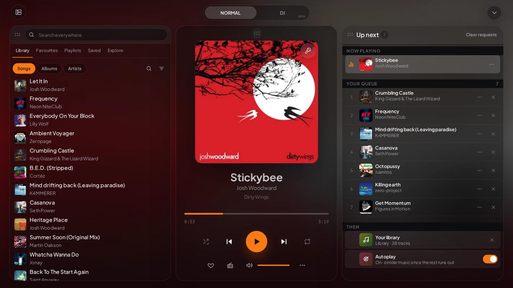
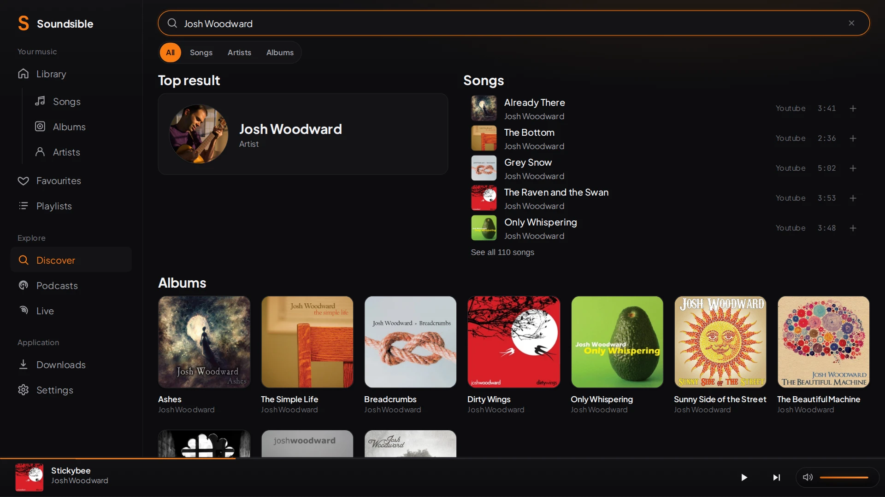
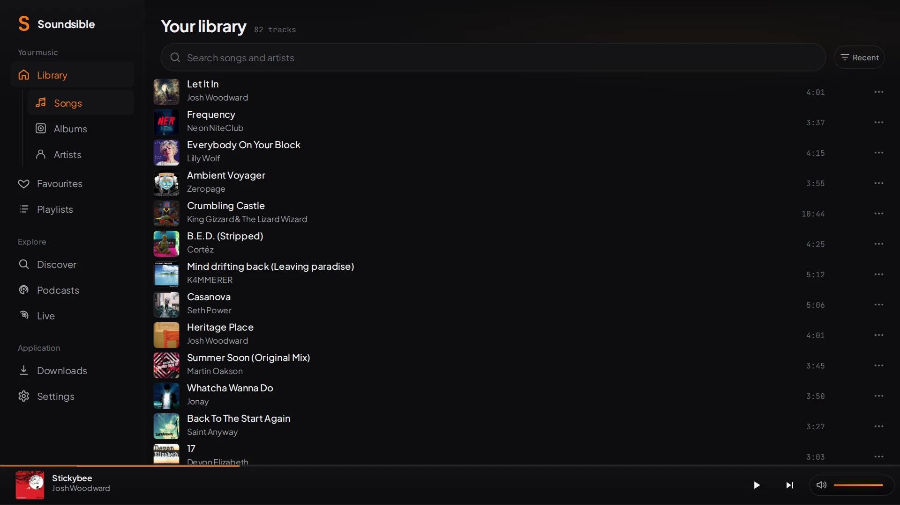
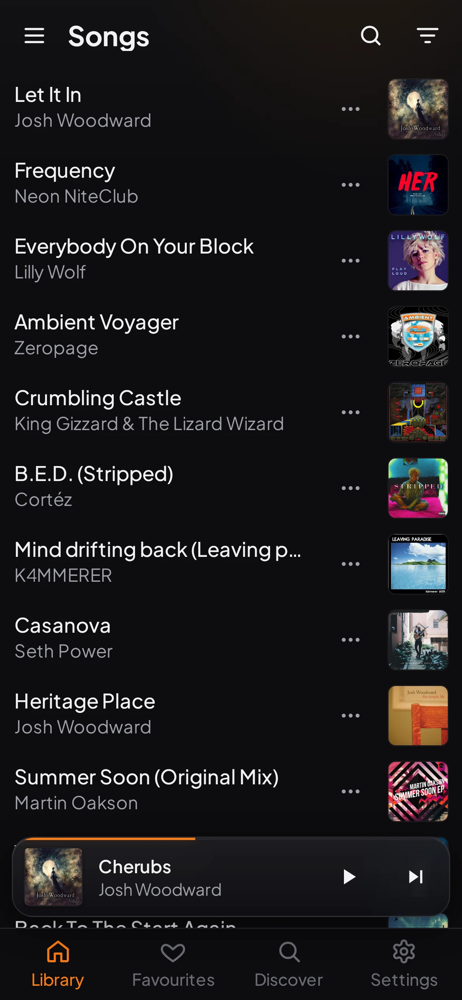
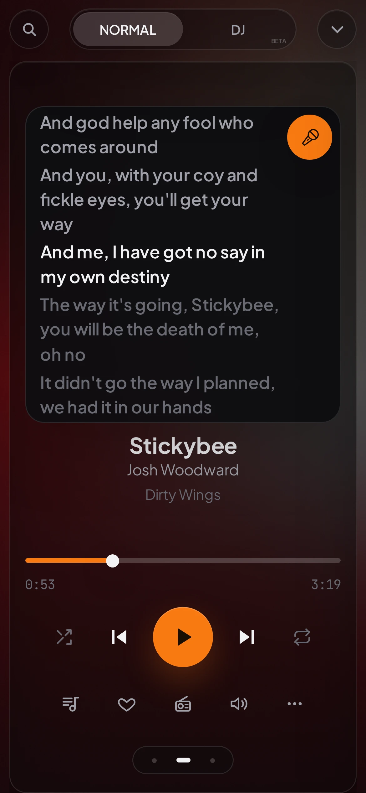

<div align="center">


# Soundsible

**A self-hosted music player. Search online music, keep a library, listen on any device.**

[Install](#install) · [Devices](#devices) · [FAQ](#faq) · [Documentation](#documentation) · [Website](https://arzuparreta.github.io/soundsible.github.io)

</div>

Soundsible runs on a computer you own — a PC, a home server, a NAS or a VPS —
and you listen through its web player, its apps or other music apps. It
searches YouTube and YouTube Music, plays your own audio files, and keeps your
library, playlists and listening history on that computer. It needs no
streaming subscription and no account with any service, and it is free and
open source (MIT).

<picture><source media="(prefers-color-scheme: light)" srcset="docs/images/screenshots/light/desktop-now-playing.webp"></picture>

<details>
<summary>More screenshots: search, library and mobile lyrics</summary>

<picture><source media="(prefers-color-scheme: light)" srcset="docs/images/screenshots/light/desktop-search.webp"></picture>
<picture><source media="(prefers-color-scheme: light)" srcset="docs/images/screenshots/light/desktop-library.webp"></picture>
<br>
<picture><source media="(prefers-color-scheme: light)" srcset="docs/images/screenshots/light/mobile-library.webp"></picture>
<picture><source media="(prefers-color-scheme: light)" srcset="docs/images/screenshots/light/mobile-now-playing.webp"></picture>

</details>

<sub>The music in the screenshots is CC BY, from Jamendo: [credits](ui_web/showcase/CREDITS.md).</sub>

## How it works

- **The server** is the Soundsible engine. It searches, downloads, stores your
  library and serves the player. It can run on the same computer you listen on.
- **The players** connect to it: any browser (installable as an app), the
  Windows app, the Android app, or apps that speak OpenSubsonic.
- **The music** comes from YouTube and YouTube Music — played straight away or
  downloaded to the server — and from audio files you already have (MP3, FLAC,
  M4A, Opus, OGG, WAV…).
- **Your data** — library, playlists, favourites, history and recommendations —
  stays on the server, separately for each account.

## Features

| | |
| --- | --- |
| **Search and play** | Search YouTube and YouTube Music, or paste a link. Play a result at once, save it to your library to stream later, or download it to the server. |
| **Library** | Browse by artist, album, genre or year. Playlists and favourites. Files you add to the music folder are picked up on a rescan. |
| **Keep listening** | Autoplay continues when your queue ends; Radio plays endlessly from one song. Recommendations learn from your listening, on your server only, and can be turned off. |
| **DJ mode** (beta) | Plays an automatic mixed set: it orders songs by tempo, key and energy and blends between them. [DJ guide](docs/AUTO_MODE.md) |
| **Live** | Broadcasts what you are playing to a public web room anyone can open without an account. [Live guide](docs/LIVE.md) |
| **Lyrics** | Time-synced lyrics, or plain text when that is all there is. |
| **Podcasts** | Search, browse charts by country, subscribe and play episodes. |
| **Import** | Bring playlists and saved songs from Spotify or Apple Music exports; Soundsible finds each song. [Import guide](docs/MUSIC_MIGRATION.md) |
| **Accounts** | Each person gets their own library, playlists, queue and history. Files are shared, so nothing downloads twice. |
| **Languages** | English, Spanish, French and Chinese. |

## Devices

| Device | How you listen | Status |
| --- | --- | --- |
| **Any browser** (desktop or phone) | Open the player; add it to the home screen to use it as an app. | Main client. Needs a connection to the server. |
| **Windows 11** (x64, ARM64) | [Desktop app](docs/DESKTOP_BETA.md): runs the server on that PC, or connects to one you already run. | Beta. Unsigned, so Windows warns about an unknown publisher. |
| **Android** | APK attached to every [release](https://github.com/Arzuparreta/soundsible/releases); [install notes](docs/android/ALPHA.md). Offline copies and Android Auto. | Alpha. Tested on an emulator; Bluetooth and individual cars unverified. Manual updates. |
| **iPhone / iPad** | The browser player. A [native app](docs/IOS.md) exists but has never been run on a device. | Native app unverified. |
| **Other music apps** | Symfonium, Feishin, Amperfy, DSub, Tempo… through [OpenSubsonic](docs/OPENSUBSONIC.md). They play your library; search, downloads and DJ stay in Soundsible. | Depends on the app. |
| **macOS, Linux** | No app: run the server natively or with Docker and use the browser. | — |

## Install

| You want to run it on… | Use |
| --- | --- |
| A server, NAS or Raspberry Pi | [Docker](docs/DOCKER.md) — prebuilt images for amd64 and arm64. |
| Linux, macOS or Windows, from source | [Native install](docs/INSTALL.md#2-install-on-your-computer) — Python, Node.js and FFmpeg. |
| Windows, without a terminal | The [desktop app](docs/DESKTOP_BETA.md) installer from the [releases](https://github.com/Arzuparreta/soundsible/releases). |

The quickest start, with Docker:

```bash
curl -O https://raw.githubusercontent.com/Arzuparreta/soundsible/main/compose.yaml
docker compose up -d
```

Then open **<http://localhost:5005/player/>**, or the server's address from
another device on your network. A native install starts with
`python3 run.py`, which opens a setup page once; the
[install guide](docs/INSTALL.md#ways-to-run-it) covers running it as a
background service.

## FAQ

**Do I need a computer switched on all the time?**
The server has to be running while you listen. That can be the computer in
front of you, or an always-on machine such as a NAS, a Raspberry Pi or a VPS.

**Can I listen away from home?**
Yes. The recommended way is [Tailscale](docs/INSTALL.md#4-remote-access-over-tailscale),
a private network between your devices. Do not expose the server directly to
the internet.

**Does it work offline?**
Only in the Android app, for songs you mark **Available offline**. The browser
player and the Windows app need the server. Some
[OpenSubsonic apps](docs/OPENSUBSONIC.md) have offline modes of their own.

**What is the sound quality?**
Music from YouTube has YouTube's lossy quality (Opus or AAC); downloads keep
that stream or convert it to MP3, as set in **Settings → Downloads**. Your own
files play as they are, FLAC included.

**What if a song is not on YouTube?**
Put the file in your music folder and rescan the library.

**Can I keep my Spotify or Apple Music playlists?**
Yes: request your data export from the service and import it. The export holds
song names, not audio, so Soundsible looks each song up.
[Import guide](docs/MUSIC_MIGRATION.md)

**Can my family use it?**
Yes. Add accounts in **Settings**; each person has their own library and
history. Adding a second account turns on sign-in.
[Accounts](docs/CONFIGURATION.md#6-accounts-multi-user)

**What leaves my server?**
The requests it needs to work: searches and streams to YouTube, search
suggestions (the text you type) to Google, song and artist lookups to Deezer
and MusicBrainz, lyrics to LRCLIB, podcast searches to Apple, and podcast feeds
and episodes to each show's own host. If you turn on automatic downloader updates,
those come from PyPI. Your listening history and recommendation profile stay on
the server and are never uploaded. Live goes through a relay run by the project, or your own,
and can be turned off.
[Privacy](docs/TELEMETRY_PRIVACY.md) · [Settings](docs/CONFIGURATION.md#features)

**Is it legal?**
Soundsible is a tool; what you download and share is your responsibility.
Use music you have the right to use. [Legal & acceptable use](docs/LEGAL.md)

**What if YouTube changes something?**
Downloads rely on [yt-dlp](https://github.com/yt-dlp/yt-dlp), which Soundsible
can keep up to date. On a VPS, YouTube often blocks datacenter addresses:
see [cookies](docs/CONFIGURATION.md#youtube-cookies) and the
[residential relay](docs/VPS_RELAY.md).

**Who makes it?**
[Arzuparreta](https://github.com/Arzuparreta), a musician and sysadmin. The
[roadmap](docs/ROADMAP.md) lists what is planned and what is out of scope —
there is no hosted version.

## Documentation

| Set up | Use | Fix and extend |
| --- | --- | --- |
| [Native install](docs/INSTALL.md) | [DJ mode](docs/AUTO_MODE.md) | [Download problems](docs/troubleshooting-yt-dlp-formats.md) |
| [Docker](docs/DOCKER.md) | [Live](docs/LIVE.md) | [Playback problems](docs/PLAYBACK_DIAGNOSIS.md) |
| [Windows app](docs/DESKTOP_BETA.md) | [Import from Spotify / Apple Music](docs/MUSIC_MIGRATION.md) | [Architecture](docs/ARCHITECTURE.md) |
| [Android app](docs/android/ALPHA.md) | [OpenSubsonic apps](docs/OPENSUBSONIC.md) | [Contributing](CONTRIBUTING.md) |
| [Settings & environment](docs/CONFIGURATION.md) | [Privacy](docs/TELEMETRY_PRIVACY.md) | [Security policy](SECURITY.md) |
| [VPS relay](docs/VPS_RELAY.md) | [Roadmap](docs/ROADMAP.md) | [All guides](docs/README.md) |

[Report a problem](https://github.com/Arzuparreta/soundsible/issues) ·
[MIT licence](LICENSE) · [Legal & acceptable use](docs/LEGAL.md)
