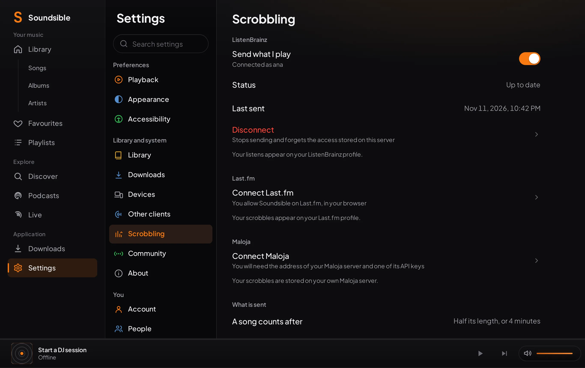

# Scrobbling

Soundsible can report each song you listen to, to **ListenBrainz**, **Last.fm**
and **Maloja**. It is off until you connect a service, and each account
connects its own.

Open **Settings → Scrobbling** in the player.

<picture><source media="(prefers-color-scheme: light)" srcset="images/scrobbling/settings-light.webp"></picture>

## What is sent, and when

The **server** sends the scrobbles, not the device you listen on. Every
Soundsible client already tells the server what it is playing, so one
connection covers the web player, the Windows app and the Android app at once.
The [iOS app](IOS.md) reports playback the same way, but it has never been run
on a device. A song played in an [OpenSubsonic app](OPENSUBSONIC.md) is passed
on as well, when that app reports it.

| | |
| --- | --- |
| **Now playing** | Sent when a song starts and when it resumes. |
| **A play** | Sent once you have listened to half the song, or to four minutes of it, whichever comes first. Songs of thirty seconds or less never count. This is the rule ListenBrainz and Last.fm publish. |
| **What it contains** | Artist, title, album, album artist, track number, length, the time the song started and — when the file has them — its MusicBrainz recording ID and ISRC. |
| **What is never sent** | Podcasts. Songs with no artist or no title. Videos whose only credit is the channel that uploaded them, because that is not the performer. |

Time spent paused does not count, and neither does seeking. Handing a song to
another device continues the same listen instead of starting a second one. A
song on repeat counts each time round.

If a service cannot be reached, the play waits on the server and is sent later,
in order, including after a restart. Settings shows how many are waiting and
why. The server keeps up to 10,000 unsent plays per service; past that the
oldest are dropped.

## ListenBrainz

1. Copy your **user token** from <https://listenbrainz.org/settings/>.
2. Press **Connect ListenBrainz** and paste it.

An admin can also connect a ListenBrainz server they host themselves, with
**Connect another ListenBrainz server**.

## Last.fm

Last.fm identifies the application as well as the listener, and Soundsible does
not ship an application key. The server needs one, once:

1. An **admin** creates an API account at <https://www.last.fm/api/account/create>.
   It is free. The form's callback URL can stay empty.
2. In **Settings → Scrobbling**, the admin presses **Add a Last.fm API key**
   and pastes the API key and the shared secret. Or set them where the engine
   starts, as `SOUNDSIBLE_LASTFM_API_KEY` and `SOUNDSIBLE_LASTFM_API_SECRET`.

Then each person connects their own Last.fm account:

1. Press **Connect Last.fm**, then **Open Last.fm**.
2. On Last.fm, press **Yes, allow access**.
3. Come back to Soundsible. It finishes on its own when you return to the page;
   **Finish connecting** does the same by hand.

The link is valid for sixty minutes. Revoking access on Last.fm
(**Settings → Applications**) is noticed on the next scrobble: Settings then
asks you to connect again, and what was waiting is sent once you do.

## Maloja

Maloja is always a server of your own, so only an **admin** can connect it:

1. Create an API key in your Maloja admin panel.
2. Press **Connect Maloja**, enter your server's address (for example
   `http://192.168.1.10:42010`) and paste the key.

Soundsible talks to Maloja through its ListenBrainz-compatible interface
(`/apis/listenbrainz`). Maloja has no "now playing"; it stores plays only.

## Pausing and disconnecting

- **Send what I play** pauses one service without disconnecting it. Songs
  played while it is off are not recorded for that service.
- **Disconnect** removes the stored access and discards what was still waiting.
  What the service already received stays there.

## Who can do what

| | Any account | Admin |
| --- | --- | --- |
| Connect their own ListenBrainz or Last.fm | ✓ | ✓ |
| Add or remove the server's Last.fm API key | | ✓ |
| Connect a server by its address (Maloja, self-hosted ListenBrainz) | | ✓ |

An address is restricted to admins because the server sends requests to it
from inside your network.

## Where it is stored

| File | Holds |
| --- | --- |
| `users/<account>/scrobble.sqlite3` in the configuration directory | That account's connections and unsent plays. Deleted with the account. |
| `scrobble.key` in the configuration directory | The key the stored tokens are encrypted with. Without it they cannot be read, and Settings asks to connect again. |
| `lastfm_app.json` in the configuration directory | The server's Last.fm API key, with its secret encrypted. |

Tokens are never shown again after you paste them and never leave the server
except to the service they belong to.
