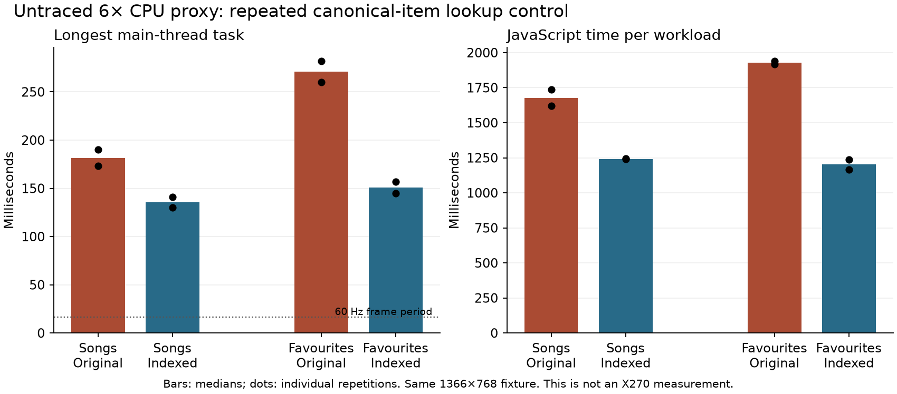

# Measured rendering architecture review

> Imported from an independent review of `00fd7d0a` (2026-11-16). Only links were rewritten. Scripts, traces, screenshots and data files it names stayed in the reviewer's working directory and are not part of the repository. Read [the handoff](../WEB_UI_REVIEW_HANDOFF.md) first: it records which findings were verified, refuted or reclassified afterwards.

Review target: `00fd7d0ae3b0d48e610d8643d6e6614e5ece63ed`. Independent rendering-performance review. All work products are outside the repository.

## Summary verdict

**Measured + read; architectural recommendation.**

Keep Solid, TypeScript, native browser scrolling and bounded virtualization; replace the inconsistent rendering contract around them.
The current implementation is not a coherent performance foundation: row entry triggers expensive account-state work, and list surfaces have very different layout/paint costs.
Verified GPU acceleration does not prevent main-thread stalls or partially presented content; the headed 144 Hz checks confirm this.
CPU throttling reproduces 0.2–0.3 second tasks, including with a small library; these are proxies, not X270 measurements.
The target is an indexed collection/presentation layer feeding lightweight, identity-stable rows and one shared scroll/virtualization policy, with explicit rendering boundaries.
Keep the media clock independent of presentation and preserve queue-occurrence identity, scroll restoration, accessibility and platform adapters.
Treat software composition as a separate failure mode; removing decorative effects did not universally cure it in this commit.
Do not commission a framework rewrite or a universal “remove blur” pass from these results. Validate the rendering redesign on actual low-end and WebView hardware.

## Findings, ranked by impact on scrolling

### 1. The virtual window is bounded, but entering it is expensive

**Measured.** At 1366×768 with the hardware GPU and 6× renderer throttling, the initial production song-list sample spent 1759.8 ms in JavaScript callbacks, 422.8 ms in style, 230.1 ms in layout and 317.3 ms in paint during its 3.49 second input interval. Its longest task was 215.4 ms; Favourites reached 343.0 ms. Only 32 rows were mounted after scrolling. A bounded node count therefore does not establish a cheap scroll path. The repeated key runs are below; full counters, source profiles and timing intervals are in `metrics.json` and each sample's `.metrics.json`.

**Read.** [ui_web/src/lib/saved.ts:14](../../../../ui_web/src/lib/saved.ts#L14) scans saved entries for each canonical-item lookup. [ui_web/src/stores/identity.ts:233](../../../../ui_web/src/stores/identity.ts#L233) routes favourite state through that scan even though an ambiguity-aware index already exists at line 69. [ui_web/src/components/FavouriteButton.tsx:28](../../../../ui_web/src/components/FavouriteButton.tsx#L28) mounts a memo around the lookup; SongRow and the mobile row adapter invoke it as rows enter. This combines work proportional to saved-collection size with repeated virtual-row construction. It is not a full-library DOM rerender: the Solid adapter reconciles retained indices.

**Measured control.** In the untraced repeated Favourites controls, the existing canonical index changed longest Long Task API duration from **260.0–282.0 ms** to **145.0–157.0 ms**, and script time from **1917.0–1940.3 ms** to **1166.7–1238.1 ms**. Earlier independent untraced controls also improved (266→155 ms longest task). The experiment preserves the fixture's item lookup but is not a validated production change for every legacy/ambiguous identity. It removes one cause, not the remaining rendering cost.

**Measured counters.** In those initial 6× samples, image-decode event time summed across threads was 11.8 ms for songs, 11.9 ms for the player browser and 3.3 ms for the queue; GC was 16.9 ms for songs and 47.5 ms for the browser. Style recalculation affected up to 576 elements in a song-list update and 298 in a browser update. Real JPEG decoding and GC are present, but neither dominates these measured stalls. This does not rule out slow real artwork delivery, larger originals or different caches on an actual device.

**Measured limits.** A 300-song/180-saved/90-favourite fixture still produced approximately 160–205 ms tasks at 6× on the tested surfaces. Saved-state scans amplify the problem; they are not its sole explanation. `clearTimeout` under row disposal is prominent in profiles, but guarding empty timer cancellation did not consistently cure untraced stalls. Choosing that small change from a profile bar would miss the larger mechanism.

**Measured + read; consequence.** Fast input can outrun row preparation. The compositor may move the surface while fresh content is late, or stop presenting updates when the main thread is saturated. More overscan builds more of the expensive UI; it is not a free safety buffer.

### 2. The rendering policy changes by surface, and painting is a separate major cost

**Read.** [ui_web/src/components/TrackList.tsx:59](../../../../ui_web/src/components/TrackList.tsx#L59) and [ui_web/src/components/VirtualRows.tsx:80](../../../../ui_web/src/components/VirtualRows.tsx#L80) window song rows. [ui_web/src/components/NowPlayingBrowser.tsx:919](../../../../ui_web/src/components/NowPlayingBrowser.tsx#L919) mounts every album navigation row; [ui_web/src/routes/Artist.tsx:397](../../../../ui_web/src/routes/Artist.tsx#L397) and [ui_web/src/routes/Album.tsx:410](../../../../ui_web/src/routes/Album.tsx#L410) mount every track. AlbumGrid and podcast subscription/search loops also mount their collections in full; episodes use a virtual window. DJ route entries do not opt into PlayerTrackList virtualization. These are different rendering contracts for related content.

**Measured.** The player album browser mounted **12,214 desktop / 12,801 mobile DOM elements** for 600 albums; the stress artist page mounted **8,052 desktop / 11,359 mobile elements** for 600 tracks. In the initial 6× samples, the album grid spent **1278.3 ms in paint** and the artist page **1384.6 ms**, with only about 49–56 ms in JS callbacks. In contrast, virtualized song lists are JS-heavy. Main-thread paint/display-list work is distinct from worker raster and GPU work.

**Measured controls.** Rendering all 6000 detailed song rows with page scripts disabled reached 108,203 elements, 295.6 ms longest task and 263.7 ms maximum displayed-frame gap. The corrected full-DOM control retains repeated row content, and remains a render-all stress case rather than exact visual equivalence; the original control also repeated first-row active state. A plain 6000-row text/art list in the same shell reduced the longest task to 34.9 ms and maximum gap to 39.2 ms at 6×, while still showing partial presentation. It removes state logic and much row structure together, so it does not identify one individual DOM element as the cause. A frozen virtual-window snapshot becomes blank after scrolling and is **rejected** as an equivalent-content performance win.

**Measured + read; consequence.** Replacing the framework or removing the virtualizer would not remove paint cost. The product needs a bounded, cheap presentation contract across lists, grids and shelves, while retaining richer interaction outside the hot row-mount path.

### 3. The player queue has a large ordinary-layout cost; no single CSS switch explains it

**Measured.** The initial 6× queue sample spent **1073.3 ms in layout** (individual runs vary), substantially more than the song list. The resume queue actually contains 46 entries, because session restoration is bounded. A separately populated live queue of approximately 600 entries retained a small mounted DOM but reached a **258.8 ms** longest task at 6×. Virtualization alone does not contain the cost of its surrounding layout and row lifecycle.

**Read.** [ui_web/src/components/PlayerTrackList.module.css:1](../../../../ui_web/src/components/PlayerTrackList.module.css#L1) and line 117 enclose the rows in a query container and nested flex lanes; [ui_web/src/components/PlayerTrackList.tsx:409](../../../../ui_web/src/components/PlayerTrackList.tsx#L409) enables variable row measurement even in the ordinary non-editing queue. These locations identify the layout graph, not a proven browser bug.

**Measured controls.** Per-row containment, list/scrollport containment, extra layer promotion, fixed overflow, removal of query containers and disabling optional row measurement did not eliminate the stalls. Reducing overscan from 10 to 2 reduced mounted elements and task size, but the browser/queue still exceeded 100 ms in that control. Increasing it to 30 produced a 424.2 ms song-list task in one run. These are interventions with geometry and workload limits, not shipping recommendations.

**Measured stacks.** Forced style/layout was much smaller than total layout: the initial browser sample recorded 22 enclosed style/layout events totalling 15.2 ms, versus 398.4 ms ordinary layout; the queue had about 15.6 ms of enclosed style/layout. Source maps point to [ui_web/src/components/NowPlayingBrowser.tsx:590](../../../../ui_web/src/components/NowPlayingBrowser.tsx#L590) reading scrollTop and the TanStack offset reader at `node_modules/@tanstack/virtual-core/dist/esm/index.js:122`. Original JS stacks remain in each metrics file. Calling the entire cost “forced synchronous layout thrashing” would be incorrect.

**Measured + read; consequence.** A rendering redesign must account for the scrollport, flex lanes, edit controls, measurement and paint scope together. A collection of unverified `contain`, `will-change` or overflow patches is not an adequate architectural answer. The exact remaining layout trigger is an open point.

### 4. Software composition adds a different bottleneck, and the old blur-only diagnosis does not generalize

**Measured.** Hardware acceleration is explicitly verified through chrome://gpu and SystemInfo. The inherited Vulkan “hardware” sample is rejected: it had disabled GPU compositing. The accepted hardware renderer is ANGLE over NVIDIA OpenGL. SwiftShader is separately named by its renderer string, even where Chrome labels a feature “hardware accelerated.”

**Measured.** In SwiftShader at 1366×768, multiple surfaces had 100–220 ms displayed-frame gaps while main-thread tasks were much shorter. The GPU-process trace spends much of the interval in `SkiaOutputSurfaceImplOnGpu::SwapBuffers`; these are elapsed swap/fence waits, not measured GPU kernel time. In the software player-browser control, the wait was about 3.17 s of the input interval. Blanket removal of filters, backdrop filters, shadows and animations left about 3.09 s of wait and still many dropped/partial frames. Queue results improved somewhat; DJ results worsened in that pair. A plain-list substitution inside the player shell still had 2942.5 ms of swap/wait and only 61/181 presented frames; replacing the whole shell with the bare 6000-row text/art scene reduced that wait to 375.1 ms with 143/143 presented (30 partial). This isolates substantial software scene cost outside the detailed list. Removing all artwork/background images helped as well, but changes more than decoding or blur. These controls do not certify a blur-only explanation for this commit.

**Read.** [ui_web/src/components/PlayerSurface.module.css:111](../../../../ui_web/src/components/PlayerSurface.module.css#L111) draws an oversized, scaled backdrop with a 62px blur and stepped animation; this is a plausible graphics cost, not sufficient proof of dominance. `app.css:94–105` already hides the covered shell after the opening transition. The older claim that the hidden application always paints does not describe this revision.

**Measured + read; consequence.** CPU throttling and software rendering expose different failures. Neither is an HD 520 measurement. Hardware compositing, software scene cost and the row/main-thread path need separate acceptance tests; a general “turn effects off” policy is unsupported.

### 5. Frame cadence alone hides late content, including on the real GPU

**Measured.** In a continuous 12,000 CSS px/s hardware-GPU gesture, the player browser presented **183/183** trace-expected frames but **162 were partial**. The song list had **82 partial among 184 presented**. Headed X11 measured a **6.944 ms** BeginFrame period on the 143.99 Hz monitor. Its normal-CPU song wheel sample had a **76.4 ms** maximum displayed-frame gap; at 6×, it had a **209.8 ms** longest task and **243.0 ms** maximum gap. These are desktop observations, not only headless output.

**Sourced.** Chromium's frame reporter explicitly distinguishes wholly presented, partially presented, wholly dropped and no-update-desired frames. A compositor update can present while a main-thread update is late. See [Chromium's explanation](https://groups.google.com/a/chromium.org/g/graphics-dev/c/vab1W1gP-iw), [the reporter implementation](https://chromium.googlesource.com/chromium/src/+/6718b706ff100957d755554cec783840a8f1f05b/cc/metrics/compositor_frame_reporter.cc), and [the smoothness discussion](https://web.dev/articles/smoothness).

**Measured + read; consequence.** An rAF counter, DrawFrame rate or 100% presented ratio can certify the wrong outcome. Acceptance must include partial presentation and visible content readiness. Older rAF-only measurements are useful history, not proof of smooth presentation.

## Keep, change or replace, in execution order

All rows are **recommendations based on measured + read evidence**. Expected effects are hypotheses to verify, not promises across untested platforms.

| Order | Decision | Expected effect | Verification |
| --- | --- | --- | --- |
| 1 | **Keep** Solid/TypeScript, DOM semantics, native scrolling, media transport and canonical/occurrence identity. | Preserve working contracts; no measured framework replacement is needed to eliminate a collection-wide lookup from each entering row. | Repeat production-input traces with current visual/interaction behavior; preserve keyboard, menus, editing, focus, scroll restoration and queue occurrence semantics. |
| 2 | **Change** collection selectors into indexed presentation data. Feed rows stable identity, artwork URL and already-derived saved/favourite/download/play state. Use the existing ambiguity-aware indexes; keep protocol and identity decisions out of row mount. | Remove repeated collection scans and reactive proxy walks. The untraced index intervention demonstrates a material but incomplete reduction. | Same fixture, order-alternated controls with tracing off and on; verify every identity/ambiguity case and state toggle, then measure task duration, callback time, mutation count and presentation completeness. |
| 3 | **Replace** separate ad hoc list policies with one rendering contract for tracks, navigation rows, grids and shelves. Share the windowing/measurement rules, while allowing desktop/mobile presentation to differ. | Bound mounted work and reduce rich component construction per entering row; prevent the album/artist/DJ exceptions from growing without a limit. | Sweep collection size and flick velocity; verify that DOM size and row-entry work track the viewport rather than total collection size. Preserve accessible offscreen navigation, edited-row pinning, collection cards and stable queue IDs. Do not just render all rows. |
| 4 | **Change** the player list/layout boundary through a measured prototype. Keep a stable allocated scrollport, a bounded content window and explicit measurement ownership; isolate edit-time variable height from ordinary fixed rows where correctness permits. | Reduce the ordinary layout and paint contribution that remains after lookup work is removed. Existing CSS toggles alone did not establish the needed result. | Trace layout roots and dirty-object counts before/after on the same geometry; compare the queue, browser and main list, including resize, edit, reorder and return-scroll flows. Accept only an intervention that reduces time and retains content/interaction. |
| 5 | **Change** the software rendering plan after scene controls establish its cost. Budget backdrops, overlapping layers, clipping and animated presentation separately from media clocks. | Avoid allowing a capable CPU to mask an expensive software compositor. This review does not promise that a pre-blurred image or blanket effect removal alone fixes it. | Compare hardware GL, SwiftShader and a bare scene with the same physical pixel count; record GPU-process waits/CPU, partial/drop frames and screenshots. Validate the eventual visual-preserving solution on actual HD 520 and WebViews. |
| 6 | **Add** production rendering acceptance to the UI architecture. | Prevent functional browser checks or framework marketing claims from substituting for rendering evidence. | Use this corpus across 1920×1080, 1366×768 and 390×844, DPR 1/3, paused/playing, wheel/fling/jump, Chromium/WebKit and target WebViews. Relate timing to the display period (16.67 ms at 60 Hz; 6.944 ms here at 144 Hz), and record full/partial/dropped/no-update separately. No arbitrary human score is needed. |

**Sourced.** TanStack documents [overscan as a render-work/blank-content tradeoff](https://tanstack.com/virtual/latest/docs/api/virtualizer). The target should own that tradeoff explicitly. “Increase overscan,” “virtualize everything,” “remove blur” and “switch framework” are not equivalent architectural decisions.

## Comparative public baseline

**Measured.** Logged-out public YouTube thumbnail search and Spotify album pages, no login or playback, same Chromium/GPU/viewport and input method. The first YouTube runs accidentally scrolled the consent dialog and are excluded. Corrected runs reject optional cookies, verify content exists and target the document results scroller. Public content, network/cache state, row counts and layout differ from the local fixture; this tests the owner's general zero-drop claim, not equal-feature efficiency or private Spotify behavior.

| Sample | Input interval, ms | P/E | Partial / dropped | Display gap p50 / p95 / max, ms | Longest main task, ms |
| --- | ---: | ---: | ---: | ---: | ---: |
| spotify, 1×, wheel, none, public-verified #0 | 3202.2 | 187/187 | 36/0 | 16.7/20.6/34.6 | 8.9 |
| youtube, 1×, wheel, none, public-verified #0 | 3200.0 | 109/110 | 17/1 | 32.9/50.5/67.6 | 20.8 |
| spotify, 6×, wheel, none, public-verified #0 | 3214.9 | 183/192 | 99/9 | 16.7/32.3/46.6 | 41.4 |
| youtube, 6×, wheel, none, public-verified #0 | 3214.9 | 72/151 | 32/79 | 25.8/130.6/178.9 | 137.5 |

**Measured interpretation.** Spotify is cheaper than the tested rich player lists, particularly under the CPU proxy. YouTube is not universally free of late or dropped frames, and its 6× run also slows. A larger DOM or more compositor layers alone does not predict the ranking. Continuous-gesture repeats in SAMPLE_INDEX.md clarify cadence, because wheel bursts can legitimately have no update between events. Their travel and duration depend on the initially scrollable content; the shorter public pages do not supply the same number of continuous frames as the long local lists. The wheel comparison above has the same offered 3.2 second workload and reverses before boundaries. The public pages' saved text, image inventory and screenshots are in `public-*-page.json` and the matching sample artifacts.

## Controls and repeat evidence

**Measured.** These are individual diagnostic samples unless the tag identifies repeats. All values are in ms; their exact input durations, load, geometry, CPU profiles and counterfactual limits are retained. The timer control, original frozen virtual window and altered full-DOM content must not be treated as complete implementation proposals.

| Sample | Input interval, ms | P/E | Partial / dropped | Display gap p50 / p95 / max, ms | Longest main task, ms |
| --- | ---: | ---: | ---: | ---: | ---: |
| browser, 6×, wheel, minimal, ablation #0 | 3201.7 | 139/184 | 61/45 | 16.9/34.0/68.2 | 153.1 |
| browser, 6×, wheel, noeffects, ablation #0 | 3529.6 | 46/210 | 41/164 | 27.7/187.2/190.7 | 192.1 |
| browser, 6×, wheel, noimages, ablation #0 | 3270.1 | 62/195 | 36/133 | 42.8/118.7/141.3 | 155.7 |
| browser, 6×, wheel, none, ablation #0 | 3482.1 | 50/208 | 46/158 | 44.1/152.4/227.0 | 224.5 |
| browser, 6×, wheel, none, overscan2 #0 | 3372.8 | 78/201 | 73/123 | 28.8/99.3/109.3 | 114.4 |
| browser, 6×, wheel, none, overscan30 #0 | 3683.9 | 40/220 | 36/180 | 51.2/244.0/311.0 | 302.5 |
| browser, 6×, wheel, none, quiet-repeat #0 | 3416.4 | 60/204 | 55/144 | 46.0/141.3/153.8 | 154.1 |
| browser, 6×, wheel, none, quiet-repeat #1 | 3475.5 | 51/206 | 47/155 | 48.4/152.1/167.6 | 164.5 |
| browser, 6×, wheel, static-full, ablation #0 | 3204.0 | 40/185 | 25/145 | 26.5/206.7/218.1 | 461.2 |
| queue, 6×, wheel, minimal, ablation #0 | 3202.2 | 156/164 | 7/8 | 16.6/34.8/130.3 | 138.2 |
| queue, 6×, wheel, noeffects, ablation #0 | 3321.8 | 58/184 | 20/126 | 23.1/159.7/203.5 | 201.1 |
| queue, 6×, wheel, noimages, ablation #0 | 3266.4 | 59/187 | 26/128 | 32.3/138.3/150.4 | 161.1 |
| queue, 6×, wheel, none, ablation #0 | 3236.2 | 64/189 | 29/125 | 32.3/138.7/162.1 | 169.1 |
| queue, 6×, wheel, none, overscan2 #0 | 3202.0 | 76/185 | 34/109 | 24.8/108.6/122.8 | 124.5 |
| queue, 6×, wheel, none, overscan30 #0 | 3228.1 | 88/184 | 38/96 | 22.9/103.8/131.0 | 139.5 |
| queue, 6×, wheel, none, quiet-repeat #0 | 3344.0 | 68/198 | 29/130 | 30.5/139.3/165.5 | 178.9 |
| queue, 6×, wheel, none, quiet-repeat #1 | 3247.6 | 65/188 | 26/123 | 32.6/137.7/162.7 | 171.5 |
| queue, 6×, wheel, static-full, ablation #0 | 3204.0 | 156/159 | 77/3 | 16.7/44.9/74.0 | 68.5 |
| songs, 6×, wheel, minimal, ablation #0 | 3203.8 | 191/191 | 68/0 | 16.6/18.1/39.2 | 34.9 |
| songs, 6×, wheel, noeffects, ablation #0 | 3573.3 | 39/214 | 34/175 | 48.1/229.7/247.3 | 234.4 |
| songs, 6×, wheel, noimages, ablation #0 | 3302.3 | 46/197 | 22/151 | 38.8/171.3/187.6 | 199.6 |
| songs, 6×, wheel, none, ablation #0 | 3609.8 | 40/216 | 35/176 | 37.9/277.6/359.1 | 347.8 |
| songs, 6×, wheel, none, overscan2 #0 | 3370.2 | 65/202 | 55/137 | 55.8/110.0/169.4 | 124.8 |
| songs, 6×, wheel, none, overscan30 #0 | 4009.3 | 33/240 | 30/207 | 85.3/355.7/413.3 | 424.2 |
| songs, 6×, wheel, none, quiet-repeat #0 | 3511.5 | 43/210 | 35/167 | 63.1/192.8/201.8 | 209.8 |
| songs, 6×, wheel, none, quiet-repeat #1 | 3506.6 | 43/210 | 37/167 | 26.6/201.9/210.2 | 206.8 |
| songs, 6×, wheel, static-full, ablation #0 | 4092.4 | 26/237 | 18/211 | 21.7/403.8/680.6 | 595.7 |
| browser, 1×, wheel, noeffects, software-ablation #0 | 3274.2 | 52/196 | 49/144 | 68.3/78.4/117.1 | 30.3 |
| browser, 1×, wheel, none, software-ablation #0 | 3340.7 | 43/199 | 40/156 | 82.5/90.6/159.0 | 39.4 |
| queue, 1×, wheel, noeffects, software-ablation #0 | 3203.2 | 84/191 | 49/107 | 50.9/78.4/104.2 | 37.4 |
| queue, 1×, wheel, none, software-ablation #0 | 3242.6 | 55/191 | 38/136 | 66.0/109.7/158.9 | 70.1 |

## Open questions and what would settle them

- **Measured method gap:** scrollbar dragging was attempted with native CDP events and Playwright mouse-state sequences, including headed and un-emulated native-window repeats, but none produced verified drag motion. Those runs are rejected, not scored as smooth or frozen. Wheel, desktop synthesized gestures, keyboard End and explicit mobile touch flicks did produce verified motion. A native/manual scrollbar recording is still needed to close that requested input path.
- **Measured limit:** the exact owner's high-end freeze, with its real library/update traffic and preferred browser/PWA, was not reproduced against the live service because that service was explicitly off limits. Settle with an owner-controlled production trace of the exact gesture, matching zoom/DPR, acceleration, selected surface and playback state, correlated with collection/socket updates. The fixture establishes rendering bottlenecks, not that every reported freeze has one cause.
- **Measured limit:** the remaining queue/browser ordinary-layout mechanism is located in the rendering graph but not isolated to one CSS property or browser defect. Settle with a presentation-only row/scrollport prototype, identical geometry and interactions, and trace layout invalidation/root changes. The tested containment/layer/query/measurement toggles did not close it.
- **Measured limit:** X270, iPhone WebKit/PWA, Android WebView and Windows WebView2 behavior remains unmeasured here. Settle with the same fixture and input corpus on those actual targets, with acceleration recorded. A 6× Ryzen or SwiftShader result is not a native device result.
- **Measured limit:** page scripts disabled, repeated row content, plain-list controls and optional query-container removal change semantics or presentation. Settle any proposed design with real state changes, menus, long press, keyboard navigation, drag/editing, scroll return and screenshot review; preserve audible media behavior independently.
- **Measured limit:** current software scene cost is not explained by the blanket effects intervention. The additional no-artwork/minimal/bare scene controls are in SAMPLE_INDEX.md. A proposed graphics fallback must prove improvement with retained appearance, rather than assume an older blur result still holds.
- **Read + measured limit:** the inherited saved-bookmark fixture has a name-field mismatch and recommendation sections are empty. Those populated surfaces need corrected payloads before making claims about them. Album/artist long membership is deliberate stress data, not typical catalog metadata. Remote search has 36 results; local search exercises the large library.
- **Measured limit:** the longest task is not the same as a user's total interaction delay, and Chrome presentation events are not photon measurements. Some idle mini-player animation reports contain dropped/no-damage-looking sequences without long main tasks. Settle user-visible consequences with a synchronized headed capture and content-readiness observation; do not report an idle low update rate as poor scrolling FPS.

## Scope, reproducibility and evidence files

**Measured.** No repository content was edited, no branch changed, no commit/PR was created, and no request was sent intentionally to port 5005. Owned fixture servers and browsers are stopped before delivery; the final cleanup record is `cleanup.json`. Review scripts build only copied trees. Original production JS bodies matched the source-map build in all 78 compared assets. Privacy searches were generic and public-site requests contained no repository content or owner identifiers.

- `METHOD.md`: precise GPU/input/frame-accounting method, units and limitations.
- `CODE_EVIDENCE.md`: read evidence with file/line locations; `sources.md`: external method references.
- `SURFACE_TABLES.md`: required per-surface production tables for all three layouts, paused/playing, 6×/4× CPU controls and SwiftShader. These tables are included below.
- `SAMPLE_INDEX.md`: traced ablations, native input, DPR, headed, live queue, small library and public repeats, with exact artifact IDs and top five costs.
- `light-controls.json`: untraced controls; `quality.json`, `QUALITY_NOTES.md`: load/activity, rejected cases and limits. Repeated key cases follow the original contended samples; no claim of universal host idleness is made.
- `bench.mjs`, `bench-v2.mjs`, `bench-v3.mjs`, `harness-*.mjs`, `compare-public.mjs`, `server.py`, `server-experiment.py`: original and corrected harnesses/fixture. Configuration manifests and logs record commands. Example: `RATE=6 SURFACES=songs,browser SIZES='[[1366,768]]' TAG=reproduction node bench-v3.mjs` with the owned fixture running.
- `<sample>.json`: geometry, DOM/layers, page/media state, load, later trajectory and CPU data; `.trace.json.gz`: Chrome trace; `.cpuprofile` and `.attribution.json`: raw/mapped JS attribution; `.metrics.json`: input-window analysis; `.png`: rendered viewport. Exact source snapshots are kept for later tagged runs; harness evolution and rejected controls are documented.
- `environment-verified.json`, `verified-*.json/.txt`, `verified-run-*.json/.txt`: hardware, executable, bundle hashes and GPU validation. The inherited `gpu-headless.json` is rejected as an accelerated-compositing baseline.

## Per-surface tables

**Measured.** P/E counts updates requested in Chrome's renderer pipeline, not elapsed time multiplied by a nominal refresh rate. Partial frames are included in P and listed separately. Display intervals are Chrome `Display::FrameDisplayed` gaps; absent intervals render as “—”. Top five costs are elapsed event time, with per-thread nesting removed within a category; categories can overlap and must not be added as CPU utilization. Raster/paint/composite/swap are distinct. Styles, element counts, forced stacks and GC remain in every metrics file even when not among the top five.

## 1920×1080 hardware GPU

**Measured.** Wheel burst, DPR 1. Counts include partial presentation; “presented” is not synonymous with fresh main-thread content. Rows are individual samples, not confidence intervals.

| Surface | State | Presented / expected | Partial / dropped | Display gap p50 / p95 / max, ms | Longest main task, ms | DOM elements / max layers | Top five event costs, ms |
| --- | --- | ---: | ---: | ---: | ---: | ---: | --- |
| Library songs | Paused | 156 / 156 | 17 / 0 | 28.3 / 47.5 / 55.8 | 19.2 | 931 / 9 | JS callbacks 528; GPU swap/wait 177; Paint 137; Style 110; GPU raster 91 |
| Library songs | Playing | 121 / 137 | 44 / 16 | 28.2 / 50.0 / 97.9 | 18.5 | 931 / 9 | JS callbacks 556; GPU swap/wait 175; Paint 152; Style 122; GPU raster 94 |
| Library albums | Paused | 158 / 158 | 31 / 0 | 24.8 / 41.0 / 56.4 | 30.0 | 5648 / 9 | Paint 469; Image decode 206; Layerize 187; GPU swap/wait 173; GPU raster 125 |
| Library albums | Playing | 124 / 136 | 52 / 12 | 27.8 / 48.2 / 83.0 | 25.9 | 5648 / 9 | Paint 453; Image decode 201; Layerize 197; GPU swap/wait 183; GPU raster 130 |
| Library artists | Paused | 150 / 150 | 0 / 0 | 24.7 / 34.9 / 58.3 | 8.4 | 1243 / 9 | GPU swap/wait 181; GPU raster 137; Layerize 103; Image decode 71; Paint 55 |
| Library artists | Playing | 79 / 95 | 0 / 16 | 35.0 / 52.3 / 88.0 | 10.2 | 1243 / 9 | GPU raster 141; Layerize 116; GPU swap/wait 93; Image decode 70; Paint 63 |
| Favourites | Paused | 177 / 177 | 49 / 0 | 21.1 / 41.5 / 54.9 | 24.0 | 927 / 9 | JS callbacks 705; GPU swap/wait 202; Paint 145; Style 110; GPU raster 103 |
| Favourites | Playing | 143 / 154 | 64 / 11 | 23.0 / 48.1 / 82.8 | 24.5 | 927 / 9 | JS callbacks 731; GPU swap/wait 169; Paint 142; Style 122; GPU raster 106 |
| Playlists grid | Paused | 159 / 159 | 0 / 0 | 22.8 / 27.7 / 61.2 | 3.8 | 1094 / 9 | GPU swap/wait 184; GPU raster 113; Layerize 68; Raster 54; Image decode 18 |
| Playlists grid | Playing | 80 / 95 | 0 / 15 | 33.8 / 51.1 / 83.2 | 4.2 | 1094 / 9 | GPU raster 117; GPU swap/wait 83; Layerize 67; Raster 52; JS callbacks 21 |
| Playlist | Paused | 150 / 150 | 13 / 0 | 27.3 / 48.6 / 56.9 | 17.1 | 907 / 9 | JS callbacks 557; GPU swap/wait 175; Paint 133; Style 110; GPU raster 86 |
| Playlist | Playing | 103 / 124 | 15 / 21 | 33.6 / 50.9 / 86.8 | 16.3 | 907 / 9 | JS callbacks 556; Paint 135; GPU swap/wait 117; Style 114; GPU raster 84 |
| Album tracks (100) | Paused | 158 / 158 | 0 / 0 | 23.2 / 27.2 / 60.8 | 7.2 | 1556 / 9 | GPU swap/wait 155; GPU raster 90; Layerize 67; Raster 38; Commit 37 |
| Album tracks (100) | Playing | 79 / 98 | 0 / 19 | 33.6 / 50.8 / 83.8 | 7.9 | 1556 / 9 | GPU raster 91; GPU swap/wait 78; Layerize 72; Commit 38; Raster 37 |
| Artist tracks (600) | Paused | 158 / 158 | 0 / 0 | 23.7 / 34.6 / 58.5 | 13.8 | 8052 / 9 | Paint 269; GPU swap/wait 162; Layerize 93; GPU raster 86; Raster 44 |
| Artist tracks (600) | Playing | 82 / 93 | 1 / 11 | 40.9 / 59.4 / 66.6 | 15.8 | 8052 / 9 | Paint 275; Layerize 98; GPU raster 90; GPU swap/wait 82; Raster 42 |
| Remote search (36) | Paused | 162 / 162 | 0 / 0 | 23.5 / 26.7 / 42.8 | 2.8 | 852 / 10 | GPU swap/wait 162; GPU raster 93; Image decode 69; Layerize 56; Raster 42 |
| Remote search (36) | Playing | 81 / 98 | 0 / 17 | 34.2 / 50.8 / 81.5 | 6.5 | 852 / 9 | GPU raster 92; GPU swap/wait 82; Layerize 59; Image decode 42; Raster 41 |
| Local search | Paused | 150 / 150 | 16 / 0 | 29.5 / 48.4 / 56.2 | 16.0 | 969 / 9 | JS callbacks 539; GPU swap/wait 159; Paint 145; Style 122; GPU raster 89 |
| Local search | Playing | 114 / 131 | 35 / 17 | 30.7 / 51.6 / 86.4 | 16.7 | 969 / 9 | JS callbacks 539; Paint 145; GPU swap/wait 130; Style 128; GPU raster 89 |
| Podcast subscriptions | Paused | 158 / 158 | 0 / 0 | 23.7 / 26.9 / 59.6 | 1.7 | 707 / 9 | GPU swap/wait 178; GPU raster 126; Image decode 85; Layerize 46; Raster 45 |
| Podcast subscriptions | Playing | 80 / 95 | 0 / 15 | 34.2 / 50.8 / 85.0 | 10.0 | 707 / 9 | GPU raster 137; GPU swap/wait 98; Image decode 93; Raster 49; Layerize 48 |
| Podcast episodes | Paused | 151 / 151 | 0 / 0 | 26.4 / 32.9 / 49.0 | 9.2 | 651 / 9 | JS callbacks 199; GPU swap/wait 147; Paint 87; GPU raster 78; Style 67 |
| Podcast episodes | Playing | 86 / 104 | 4 / 18 | 34.2 / 50.9 / 78.1 | 16.1 | 651 / 9 | JS callbacks 217; Paint 95; GPU swap/wait 91; GPU raster 86; Style 78 |
| Player songs browser | Paused | 134 / 134 | 34 / 0 | 20.7 / 49.0 / 52.5 | 26.7 | 1751 / 15 | JS callbacks 408; Layout 220; GPU swap/wait 191; Paint 146; GPU raster 139 |
| Player songs browser | Playing | 131 / 131 | 6 / 0 | 30.8 / 47.2 / 50.9 | 14.2 | 1751 / 15 | JS callbacks 358; Layout 189; GPU swap/wait 157; Layerize 141; Paint 138 |
| Player albums browser | Paused | 119 / 119 | 35 / 0 | 26.8 / 50.6 / 78.2 | 25.0 | 12314 / 15 | Paint 348; Layerize 214; GPU swap/wait 145; GPU raster 109; Commit 103 |
| Player albums browser | Playing | 143 / 143 | 39 / 0 | 24.4 / 47.6 / 62.0 | 24.2 | 12314 / 15 | Paint 353; Layerize 243; GPU swap/wait 173; Commit 127; GPU raster 114 |
| Player artists browser | Paused | 159 / 159 | 70 / 0 | 16.6 / 44.6 / 82.8 | 20.3 | 2249 / 15 | Layout 383; Paint 259; JS callbacks 231; GPU swap/wait 192; Layerize 121 |
| Player artists browser | Playing | 173 / 173 | 71 / 0 | 14.6 / 43.9 / 81.3 | 22.2 | 2249 / 15 | Layout 383; Paint 277; JS callbacks 238; GPU swap/wait 208; Layerize 154 |
| Player queue (resume) | Paused | 138 / 138 | 55 / 0 | 25.8 / 49.1 / 52.9 | 25.8 | 1832 / 15 | Layout 441; JS callbacks 248; GPU swap/wait 167; Paint 167; Layerize 127 |
| Player queue (resume) | Playing | 148 / 148 | 54 / 0 | 24.9 / 47.7 / 51.6 | 25.4 | 1832 / 15 | Layout 454; JS callbacks 260; GPU swap/wait 179; Paint 169; Layerize 150 |
| DJ route | Paused | 84 / 84 | 1 / 0 | 33.7 / 50.8 / 54.7 | 13.1 | 3456 / 12 | Layerize 158; GPU swap/wait 102; Commit 19; Viz draw 16; GPU raster 16 |
| DJ route | Playing | 92 / 92 | 0 / 0 | 33.5 / 50.1 / 51.2 | 6.7 | 3456 / 12 | Layerize 239; GPU swap/wait 114; Style 23; GPU raster 20; JS callbacks 20 |

## 1366×768 hardware GPU

**Measured.** Wheel burst, DPR 1. Counts include partial presentation; “presented” is not synonymous with fresh main-thread content. Rows are individual samples, not confidence intervals.

| Surface | State | Presented / expected | Partial / dropped | Display gap p50 / p95 / max, ms | Longest main task, ms | DOM elements / max layers | Top five event costs, ms |
| --- | --- | ---: | ---: | ---: | ---: | ---: | --- |
| Library songs | Paused | 149 / 149 | 12 / 0 | 28.4 / 49.1 / 60.2 | 17.5 | 823 / 9 | JS callbacks 494; Paint 144; Style 111; GPU swap/wait 95; GPU raster 73 |
| Library songs | Playing | 102 / 120 | 23 / 18 | 32.8 / 51.1 / 86.4 | 17.7 | 823 / 9 | JS callbacks 515; Paint 148; Style 117; GPU raster 73; GPU swap/wait 70 |
| Library albums | Paused | 152 / 152 | 3 / 0 | 24.0 / 41.6 / 44.3 | 15.1 | 5648 / 9 | Paint 299; Image decode 136; Layerize 92; GPU swap/wait 85; Commit 82 |
| Library albums | Playing | 97 / 110 | 12 / 13 | 38.0 / 59.7 / 83.4 | 19.7 | 5648 / 9 | Paint 296; Image decode 136; Layerize 100; Commit 87; GPU raster 68 |
| Library artists | Paused | 152 / 152 | 0 / 0 | 21.5 / 32.9 / 46.4 | 6.5 | 1243 / 9 | Paint 95; GPU swap/wait 91; Image decode 77; Layerize 75; GPU raster 67 |
| Library artists | Playing | 80 / 94 | 0 / 14 | 34.8 / 53.4 / 83.1 | 6.7 | 1243 / 9 | Paint 100; Layerize 77; Image decode 75; GPU raster 68; GPU swap/wait 51 |
| Favourites | Paused | 175 / 176 | 51 / 1 | 19.3 / 43.7 / 56.3 | 34.5 | 819 / 9 | JS callbacks 746; Paint 186; GPU swap/wait 138; Style 133; Layout 91 |
| Favourites | Playing | 158 / 166 | 75 / 8 | 21.3 / 45.2 / 86.6 | 37.7 | 819 / 9 | JS callbacks 807; Paint 191; GPU swap/wait 151; Style 150; GPU raster 97 |
| Playlists grid | Paused | 157 / 157 | 0 / 0 | 19.9 / 30.4 / 63.0 | 3.3 | 1094 / 9 | GPU swap/wait 99; Layerize 63; GPU raster 54; Image decode 28; Raster 21 |
| Playlists grid | Playing | 80 / 93 | 0 / 13 | 33.8 / 50.5 / 83.1 | 3.6 | 1094 / 9 | Layerize 63; GPU raster 54; GPU swap/wait 52; Image decode 27; JS callbacks 24 |
| Playlist | Paused | 140 / 140 | 3 / 0 | 28.6 / 49.9 / 60.1 | 14.6 | 799 / 9 | JS callbacks 481; Paint 139; Style 106; GPU swap/wait 95; GPU raster 71 |
| Playlist | Playing | 120 / 136 | 38 / 16 | 29.7 / 50.8 / 72.3 | 20.9 | 799 / 9 | JS callbacks 548; Paint 155; Style 127; GPU swap/wait 95; GPU raster 76 |
| Album tracks (100) | Paused | 158 / 158 | 0 / 0 | 21.4 / 28.9 / 45.8 | 6.8 | 1556 / 9 | GPU swap/wait 98; Layerize 68; GPU raster 63; Raster 30; Commit 25 |
| Album tracks (100) | Playing | 79 / 97 | 0 / 18 | 34.0 / 52.0 / 84.2 | 7.6 | 1556 / 9 | Layerize 76; GPU raster 65; GPU swap/wait 50; JS callbacks 33; Commit 31 |
| Artist tracks (600) | Paused | 160 / 160 | 3 / 0 | 22.6 / 35.3 / 58.6 | 15.6 | 8052 / 9 | Paint 253; GPU swap/wait 114; Layerize 99; GPU raster 72; Commit 34 |
| Artist tracks (600) | Playing | 79 / 97 | 0 / 18 | 41.5 / 60.2 / 80.8 | 13.7 | 8052 / 9 | Paint 243; Layerize 103; GPU raster 68; GPU swap/wait 56; Commit 32 |
| Remote search (36) | Paused | 123 / 123 | 0 / 0 | 22.0 / 61.7 / 63.0 | 3.9 | 852 / 10 | GPU swap/wait 86; Image decode 84; Layerize 55; GPU raster 52; Commit 41 |
| Remote search (36) | Playing | 63 / 90 | 0 / 27 | 49.3 / 83.8 / 84.5 | 3.6 | 852 / 9 | Image decode 64; Layerize 52; GPU raster 52; GPU swap/wait 38; Commit 34 |
| Local search | Paused | 167 / 167 | 35 / 0 | 19.7 / 42.9 / 55.9 | 24.2 | 855 / 9 | JS callbacks 646; Paint 176; GPU swap/wait 144; Style 124; Layout 86 |
| Local search | Playing | 134 / 150 | 57 / 16 | 26.0 / 49.2 / 85.8 | 20.2 | 855 / 9 | JS callbacks 636; Paint 153; Style 137; GPU swap/wait 103; Layout 82 |
| Podcast subscriptions | Paused | 158 / 159 | 1 / 1 | 20.7 / 30.1 / 75.6 | 6.2 | 707 / 9 | GPU swap/wait 129; Image decode 116; GPU raster 71; Layerize 58; Raster 37 |
| Podcast subscriptions | Playing | 79 / 97 | 0 / 18 | 34.5 / 52.9 / 84.1 | 5.4 | 707 / 9 | Image decode 110; GPU raster 77; Layerize 59; GPU swap/wait 57; Raster 39 |
| Podcast episodes | Paused | 154 / 154 | 0 / 0 | 25.5 / 32.7 / 58.3 | 9.8 | 591 / 9 | JS callbacks 252; GPU swap/wait 114; Style 93; Paint 89; GPU raster 64 |
| Podcast episodes | Playing | 82 / 102 | 0 / 20 | 34.2 / 51.7 / 87.6 | 10.6 | 591 / 9 | JS callbacks 247; Style 102; Paint 88; GPU raster 62; Layout 61 |
| Player songs browser | Paused | 127 / 127 | 31 / 0 | 27.9 / 48.9 / 53.5 | 22.6 | 1489 / 15 | JS callbacks 465; Layout 191; Style 127; Paint 125; GPU swap/wait 119 |
| Player songs browser | Playing | 157 / 157 | 44 / 0 | 19.4 / 45.3 / 52.8 | 18.9 | 1489 / 15 | JS callbacks 483; Layout 197; GPU swap/wait 150; Style 145; Paint 118 |
| Player albums browser | Paused | 128 / 128 | 47 / 0 | 25.0 / 50.8 / 76.7 | 27.7 | 12214 / 15 | Paint 341; Layerize 191; Commit 105; GPU swap/wait 103; GPU raster 93 |
| Player albums browser | Playing | 145 / 145 | 40 / 0 | 19.6 / 49.1 / 73.8 | 27.7 | 12214 / 15 | Paint 382; Layerize 225; Commit 132; GPU swap/wait 118; GPU raster 95 |
| Player artists browser | Paused | 136 / 137 | 44 / 1 | 26.5 / 49.5 / 87.9 | 29.6 | 2095 / 15 | Layout 394; JS callbacks 247; Paint 204; Style 117; GPU swap/wait 109 |
| Player artists browser | Playing | 155 / 155 | 47 / 0 | 18.8 / 47.6 / 66.2 | 26.7 | 2095 / 15 | Layout 408; JS callbacks 246; Paint 198; GPU swap/wait 118; Layerize 116 |
| Player queue (resume) | Paused | 124 / 124 | 42 / 0 | 28.4 / 53.5 / 87.8 | 23.3 | 1570 / 15 | Layout 443; JS callbacks 246; Paint 140; Layerize 101; GPU swap/wait 95 |
| Player queue (resume) | Playing | 147 / 147 | 45 / 0 | 25.8 / 47.5 / 55.9 | 25.3 | 1570 / 15 | Layout 445; JS callbacks 254; Paint 141; Layerize 124; GPU swap/wait 111 |
| DJ route | Paused | 83 / 83 | 0 / 0 | 33.5 / 50.8 / 84.2 | 9.0 | 3134 / 12 | Layerize 170; GPU swap/wait 67; Commit 19; Viz draw 17; GPU raster 13 |
| DJ route | Playing | 89 / 89 | 0 / 0 | 33.5 / 51.0 / 82.7 | 9.3 | 3134 / 12 | Layerize 252; GPU swap/wait 72; Style 25; JS callbacks 21; Commit 20 |

## 390×844 mobile layout, hardware GPU

**Measured.** Wheel burst, DPR 1. Counts include partial presentation; “presented” is not synonymous with fresh main-thread content. Rows are individual samples, not confidence intervals.

| Surface | State | Presented / expected | Partial / dropped | Display gap p50 / p95 / max, ms | Longest main task, ms | DOM elements / max layers | Top five event costs, ms |
| --- | --- | ---: | ---: | ---: | ---: | ---: | --- |
| Library songs | Paused | 178 / 179 | 43 / 1 | 17.1 / 31.8 / 46.4 | 17.4 | 837 / 13 | JS callbacks 832; Style 119; Paint 117; Layout 87; GPU swap/wait 53 |
| Library songs | Playing | 168 / 184 | 52 / 16 | 16.7 / 33.4 / 50.2 | 29.3 | 837 / 13 | JS callbacks 814; Style 121; Paint 120; Layout 91; GPU swap/wait 55 |
| Library albums | Paused | 140 / 140 | 19 / 0 | 19.7 / 50.0 / 51.6 | 16.1 | 5646 / 13 | Paint 188; Commit 153; Image decode 58; GPU swap/wait 52; Layerize 33 |
| Library albums | Playing | 158 / 158 | 48 / 0 | 16.7 / 33.5 / 50.2 | 13.1 | 5646 / 13 | Paint 178; Commit 154; Image decode 59; GPU swap/wait 57; Layerize 35 |
| Library artists | Paused | 142 / 142 | 20 / 0 | 19.3 / 49.8 / 50.7 | 4.5 | 1242 / 13 | Paint 109; Image decode 63; GPU swap/wait 53; Commit 39; Layerize 25 |
| Library artists | Playing | 158 / 158 | 43 / 0 | 16.7 / 33.6 / 50.2 | 5.2 | 1242 / 13 | Paint 109; Image decode 64; GPU swap/wait 57; Commit 41; JS callbacks 33 |
| Favourites | Paused | 179 / 180 | 24 / 1 | 16.9 / 33.2 / 34.5 | 18.8 | 776 / 13 | JS callbacks 639; Paint 144; Style 112; Layout 78; GPU swap/wait 63 |
| Favourites | Playing | 169 / 180 | 50 / 11 | 16.7 / 33.5 / 34.0 | 22.0 | 776 / 13 | JS callbacks 646; Paint 135; Style 115; Layout 79; GPU swap/wait 65 |
| Playlists grid | Paused | 129 / 129 | 10 / 0 | 17.4 / 50.2 / 51.5 | 8.9 | 1101 / 13 | Paint 107; GPU swap/wait 48; Image decode 30; Layerize 27; JS callbacks 27 |
| Playlists grid | Playing | 142 / 142 | 24 / 0 | 16.8 / 49.6 / 51.5 | 8.5 | 1101 / 13 | Paint 106; GPU swap/wait 54; JS callbacks 38; Layerize 29; Commit 29 |
| Playlist | Paused | 187 / 191 | 74 / 4 | 17.1 / 33.6 / 50.2 | 32.9 | 803 / 13 | JS callbacks 1203; Paint 131; Style 127; Layout 94; GPU swap/wait 60 |
| Playlist | Playing | 155 / 189 | 56 / 34 | 16.7 / 33.7 / 66.5 | 51.9 | 803 / 13 | JS callbacks 1215; Paint 142; Style 141; Layout 101; GPU swap/wait 60 |
| Album tracks (100) | Paused | 124 / 124 | 4 / 0 | 17.3 / 50.1 / 50.3 | 10.1 | 2113 / 14 | Paint 168; GPU swap/wait 44; Layerize 38; JS callbacks 29; Commit 28 |
| Album tracks (100) | Playing | 141 / 141 | 12 / 0 | 16.7 / 49.9 / 50.5 | 10.7 | 2113 / 14 | Paint 167; GPU swap/wait 51; Layerize 46; JS callbacks 41; Commit 30 |
| Artist tracks (600) | Paused | 158 / 159 | 46 / 1 | 30.9 / 41.6 / 50.5 | 35.4 | 11359 / 14 | Paint 435; Commit 111; Layerize 74; GPU swap/wait 52; PrePaint 31 |
| Artist tracks (600) | Playing | 143 / 172 | 39 / 29 | 16.7 / 33.6 / 49.9 | 23.1 | 11359 / 14 | Paint 386; Layerize 82; Commit 79; GPU swap/wait 53; PrePaint 53 |
| Remote search (36) | Paused | 185 / 185 | 11 / 0 | 16.7 / 29.7 / 34.0 | 3.5 | 913 / 15 | Paint 154; Image decode 64; GPU swap/wait 59; Layerize 30; JS callbacks 24 |
| Remote search (36) | Playing | 175 / 175 | 19 / 0 | 16.7 / 33.5 / 48.7 | 4.1 | 913 / 15 | Paint 139; Image decode 73; GPU swap/wait 61; Layerize 34; JS callbacks 32 |
| Local search | Paused | 181 / 182 | 44 / 1 | 17.5 / 32.4 / 38.4 | 19.2 | 852 / 13 | JS callbacks 809; Paint 134; Style 104; Layout 90; GPU swap/wait 60 |
| Local search | Playing | 166 / 179 | 53 / 13 | 16.7 / 33.5 / 50.1 | 29.1 | 852 / 13 | JS callbacks 794; Paint 128; Style 113; Layout 92; GPU swap/wait 74 |
| Podcast subscriptions | Paused | 124 / 124 | 4 / 0 | 19.2 / 50.5 / 51.6 | 5.3 | 715 / 13 | Image decode 99; Paint 80; GPU swap/wait 53; JS callbacks 36; Commit 30 |
| Podcast subscriptions | Playing | 145 / 145 | 32 / 0 | 16.7 / 50.3 / 50.8 | 4.6 | 715 / 13 | Image decode 105; Paint 80; GPU swap/wait 69; JS callbacks 42; Commit 27 |
| Podcast episodes | Paused | 170 / 171 | 12 / 1 | 17.7 / 27.4 / 33.3 | 13.3 | 733 / 14 | JS callbacks 512; Paint 114; Style 83; GPU swap/wait 72; Layout 70 |
| Podcast episodes | Playing | 175 / 175 | 65 / 0 | 16.7 / 33.6 / 33.9 | 14.5 | 733 / 14 | JS callbacks 547; Paint 114; Style 93; GPU swap/wait 92; Layout 72 |
| Player songs browser | Paused | 169 / 170 | 66 / 1 | 16.7 / 33.5 / 50.5 | 21.0 | 1580 / 26 | JS callbacks 489; Paint 128; Style 104; GPU swap/wait 94; Layout 69 |
| Player songs browser | Playing | 173 / 174 | 52 / 1 | 16.7 / 33.5 / 50.0 | 19.5 | 1579 / 26 | JS callbacks 495; Paint 144; Style 107; Layerize 84; GPU swap/wait 84 |
| Player albums browser | Paused | 117 / 149 | 36 / 32 | 33.1 / 33.7 / 83.5 | 27.2 | 12801 / 26 | Paint 232; Commit 218; Layerize 81; GPU swap/wait 47; Viz draw 34 |
| Player albums browser | Playing | 124 / 156 | 39 / 32 | 32.6 / 33.7 / 80.3 | 28.6 | 12800 / 26 | Paint 264; Commit 233; Layerize 126; GPU swap/wait 50; Viz draw 34 |
| Player artists browser | Paused | 170 / 171 | 70 / 1 | 16.7 / 33.5 / 66.8 | 13.1 | 2105 / 26 | JS callbacks 372; Paint 136; Style 82; Layout 63; GPU swap/wait 58 |
| Player artists browser | Playing | 169 / 170 | 67 / 1 | 16.7 / 33.4 / 66.6 | 15.0 | 2104 / 26 | JS callbacks 378; Paint 143; Style 84; Layerize 66; Layout 62 |
| Player queue (resume) | Paused | 160 / 161 | 79 / 1 | 16.7 / 33.6 / 66.8 | 14.8 | 1687 / 26 | JS callbacks 367; Layout 92; Paint 91; Layerize 59; GPU swap/wait 58 |
| Player queue (resume) | Playing | 169 / 170 | 81 / 1 | 16.7 / 33.6 / 66.9 | 14.0 | 1686 / 26 | JS callbacks 360; Paint 94; Layout 92; Layerize 74; GPU swap/wait 62 |
| DJ route | Paused | 85 / 85 | 1 / 0 | 33.5 / 50.3 / 66.7 | 9.8 | 3617 / 24 | GPU swap/wait 34; Commit 29; Viz draw 23; JS callbacks 12; Style 11 |
| DJ route | Playing | 98 / 98 | 14 / 0 | 33.3 / 50.3 / 66.5 | 10.2 | 3616 / 24 | Layerize 45; GPU swap/wait 38; Commit 31; Paint 27; Viz draw 26 |

## 1366×768, 6× renderer CPU proxy

**Measured.** Wheel burst, DPR 1. Counts include partial presentation; “presented” is not synonymous with fresh main-thread content. Rows are individual samples, not confidence intervals.

| Surface | State | Presented / expected | Partial / dropped | Display gap p50 / p95 / max, ms | Longest main task, ms | DOM elements / max layers | Top five event costs, ms |
| --- | --- | ---: | ---: | ---: | ---: | ---: | --- |
| Library songs | Paused | 43 / 209 | 34 / 166 | 60.2 / 211.2 / 228.4 | 215.4 | 823 / 9 | JS callbacks 1760; Style 423; Paint 317; Layout 230; PrePaint 86 |
| Library albums | Paused | 83 / 191 | 77 / 108 | 22.8 / 90.9 / 100.9 | 115.2 | 5648 / 9 | Paint 1278; Commit 254; Layerize 233; Image decode 109; JS callbacks 49 |
| Library artists | Paused | 148 / 173 | 44 / 25 | 22.4 / 55.6 / 69.2 | 54.5 | 1243 / 9 | Paint 532; Layerize 392; Commit 120; GPU swap/wait 89; JS callbacks 86 |
| Favourites | Paused | 37 / 218 | 33 / 181 | 41.5 / 255.5 / 343.6 | 343.0 | 819 / 9 | JS callbacks 2135; Style 370; Paint 281; Layout 210; PrePaint 71 |
| Playlists grid | Paused | 157 / 159 | 7 / 2 | 24.5 / 29.9 / 58.5 | 27.8 | 1094 / 9 | Layerize 406; GPU swap/wait 100; Commit 93; Paint 92; GPU raster 55 |
| Playlist | Paused | 42 / 181 | 24 / 139 | 25.7 / 243.7 / 245.3 | 232.9 | 781 / 9 | JS callbacks 1719; Style 420; Paint 256; Layout 197; PrePaint 82 |
| Album tracks (100) | Paused | 158 / 159 | 1 / 1 | 22.4 / 32.3 / 66.6 | 47.3 | 1556 / 9 | Layerize 456; Commit 149; GPU swap/wait 95; JS callbacks 68; GPU raster 65 |
| Artist tracks (600) | Paused | 92 / 186 | 52 / 94 | 20.6 / 83.1 / 110.5 | 89.4 | 8052 / 9 | Paint 1385; Layerize 392; Commit 135; JS callbacks 56; GPU swap/wait 55 |
| Remote search (36) | Paused | 125 / 125 | 3 / 0 | 28.1 / 54.4 / 56.5 | 15.0 | 852 / 10 | Layerize 232; Commit 177; Image decode 84; GPU swap/wait 74; JS callbacks 62 |
| Local search | Paused | 39 / 215 | 35 / 176 | 76.2 / 230.1 / 241.1 | 225.8 | 855 / 9 | JS callbacks 1820; Style 458; Paint 305; Layout 248; PrePaint 85 |
| Podcast subscriptions | Paused | 158 / 158 | 2 / 0 | 24.3 / 31.2 / 64.5 | 23.9 | 707 / 9 | Layerize 232; Image decode 113; GPU swap/wait 111; GPU raster 68; Commit 64 |
| Podcast episodes | Paused | 122 / 185 | 83 / 63 | 23.7 / 60.1 / 81.7 | 76.6 | 591 / 9 | JS callbacks 1028; Paint 389; Style 362; Layout 254; Layerize 126 |
| Player songs browser | Paused | 55 / 208 | 50 / 153 | 35.9 / 152.6 / 170.3 | 166.6 | 1489 / 15 | JS callbacks 1438; Style 419; Layout 398; Paint 284; Layerize 151 |
| Player albums browser | Paused | 64 / 204 | 60 / 140 | 27.8 / 84.2 / 119.5 | 146.8 | 12214 / 15 | Paint 1162; Layerize 399; Commit 209; PrePaint 116; GPU swap/wait 71 |
| Player artists browser | Paused | 54 / 207 | 52 / 153 | 18.7 / 131.2 / 150.2 | 185.0 | 2095 / 15 | JS callbacks 897; Layout 808; Paint 492; Style 364; Layerize 183 |
| Player queue (resume) | Paused | 60 / 192 | 28 / 132 | 32.4 / 139.6 / 188.2 | 183.1 | 1570 / 15 | Layout 1073; JS callbacks 868; Paint 327; Layerize 175; PrePaint 136 |
| DJ route | Paused | 155 / 158 | 76 / 3 | 17.0 / 46.8 / 56.5 | 67.0 | 3134 / 12 | Layerize 1056; Commit 136; GPU swap/wait 131; Style 100; JS callbacks 90 |

## 1366×768, 4× renderer CPU proxy

**Measured.** Wheel burst, DPR 1. Counts include partial presentation; “presented” is not synonymous with fresh main-thread content. Rows are individual samples, not confidence intervals.

| Surface | State | Presented / expected | Partial / dropped | Display gap p50 / p95 / max, ms | Longest main task, ms | DOM elements / max layers | Top five event costs, ms |
| --- | --- | ---: | ---: | ---: | ---: | ---: | --- |
| Library songs | Paused | 62 / 199 | 49 / 137 | 36.0 / 143.1 / 187.3 | 201.9 | 823 / 9 | JS callbacks 1743; Style 360; Paint 300; Layout 217; PrePaint 90 |
| Favourites | Paused | 40 / 214 | 32 / 174 | 70.9 / 258.7 / 383.4 | 398.8 | 819 / 9 | JS callbacks 2274; Style 309; Paint 215; Layout 163; PrePaint 62 |
| Player songs browser | Paused | 77 / 199 | 73 / 122 | 30.0 / 104.4 / 135.1 | 147.1 | 1489 / 15 | JS callbacks 1293; Layout 458; Style 355; Paint 316; Layerize 169 |
| Player queue (resume) | Paused | 90 / 191 | 40 / 101 | 26.6 / 89.8 / 110.0 | 103.9 | 1570 / 15 | Layout 1003; JS callbacks 724; Paint 318; Layerize 190; PrePaint 123 |

## 1366×768, SwiftShader

**Measured.** Wheel burst, DPR 1. Counts include partial presentation; “presented” is not synonymous with fresh main-thread content. Rows are individual samples, not confidence intervals.

| Surface | State | Presented / expected | Partial / dropped | Display gap p50 / p95 / max, ms | Longest main task, ms | DOM elements / max layers | Top five event costs, ms |
| --- | --- | ---: | ---: | ---: | ---: | ---: | --- |
| Library songs | Paused | 44 / 196 | 38 / 152 | 80.0 / 101.7 / 149.6 | 41.1 | 823 / 9 | GPU swap/wait 3106; JS callbacks 625; Style 150; Paint 136; Layout 91 |
| Library songs | Playing | 44 / 193 | 41 / 149 | 76.8 / 95.4 / 140.1 | 44.9 | 823 / 9 | GPU swap/wait 2998; JS callbacks 589; Style 147; Paint 132; Layout 91 |
| Library albums | Paused | 64 / 195 | 40 / 131 | 69.8 / 97.3 / 147.0 | 26.0 | 5648 / 9 | GPU swap/wait 2950; Paint 288; Image decode 126; Commit 65; Layerize 64 |
| Library artists | Paused | 62 / 185 | 22 / 123 | 69.7 / 132.1 / 151.9 | 10.1 | 1243 / 9 | GPU swap/wait 2910; Paint 91; Image decode 69; Layerize 44; GPU raster 35 |
| Favourites | Paused | 45 / 199 | 39 / 154 | 88.5 / 112.5 / 170.4 | 54.3 | 819 / 9 | GPU swap/wait 3189; JS callbacks 755; Style 133; Paint 119; Layout 85 |
| Playlists grid | Paused | 116 / 141 | 5 / 25 | 35.4 / 52.6 / 111.4 | 5.1 | 1094 / 9 | GPU swap/wait 2664; Layerize 86; GPU raster 48; Commit 31; Image decode 29 |
| Playlist | Paused | 54 / 185 | 35 / 131 | 77.8 / 97.4 / 132.5 | 47.7 | 799 / 9 | GPU swap/wait 3026; JS callbacks 561; Style 137; Paint 119; Layout 77 |
| Album tracks (100) | Paused | 62 / 194 | 20 / 132 | 71.3 / 143.5 / 181.4 | 9.8 | 1556 / 9 | GPU swap/wait 2944; Layerize 49; Commit 37; GPU raster 30; Raster 21 |
| Artist tracks (600) | Paused | 73 / 189 | 30 / 116 | 70.9 / 104.5 / 114.7 | 22.4 | 8052 / 9 | GPU swap/wait 2840; Paint 269; Layerize 55; Commit 39; GPU raster 31 |
| Remote search (36) | Paused | 72 / 185 | 30 / 113 | 73.4 / 89.3 / 146.3 | 5.0 | 852 / 10 | GPU swap/wait 2957; Image decode 89; Layerize 40; Commit 39; GPU raster 33 |
| Local search | Paused | 49 / 198 | 44 / 149 | 77.0 / 86.7 / 99.3 | 39.7 | 855 / 9 | GPU swap/wait 3159; JS callbacks 627; Style 145; Paint 142; Layout 104 |
| Podcast subscriptions | Paused | 68 / 188 | 24 / 120 | 71.3 / 107.9 / 223.8 | 5.9 | 707 / 9 | GPU swap/wait 2763; Image decode 106; GPU raster 28; Layerize 28; Commit 23 |
| Podcast episodes | Paused | 65 / 192 | 32 / 127 | 81.5 / 97.0 / 166.8 | 25.2 | 591 / 9 | GPU swap/wait 2929; JS callbacks 202; Style 82; Paint 68; Layout 49 |
| Player songs browser | Paused | 43 / 199 | 41 / 156 | 81.2 / 90.5 / 123.4 | 34.5 | 1489 / 15 | GPU swap/wait 3181; JS callbacks 382; Layout 127; Style 116; Paint 92 |
| Player songs browser | Playing | 43 / 197 | 41 / 154 | 81.5 / 85.9 / 99.8 | 31.8 | 1489 / 15 | GPU swap/wait 3161; JS callbacks 407; Layout 151; Style 127; Paint 92 |
| Player albums browser | Paused | 57 / 191 | 28 / 134 | 90.8 / 98.2 / 103.9 | 32.1 | 12214 / 15 | GPU swap/wait 3087; Paint 269; Layerize 83; Commit 63; GPU raster 33 |
| Player artists browser | Paused | 40 / 201 | 38 / 161 | 92.7 / 105.1 / 154.1 | 32.8 | 2095 / 15 | GPU swap/wait 3217; JS callbacks 231; Layout 227; Paint 118; Style 98 |
| Player queue (resume) | Paused | 64 / 194 | 32 / 130 | 65.7 / 89.5 / 98.6 | 38.7 | 1570 / 15 | GPU swap/wait 3054; Layout 310; JS callbacks 221; Paint 91; Layerize 55 |
| Player queue (resume) | Playing | 62 / 192 | 39 / 130 | 78.2 / 101.1 / 144.2 | 41.5 | 1570 / 15 | GPU swap/wait 3033; Layout 270; JS callbacks 225; Paint 98; Layerize 72 |
| DJ route | Paused | 85 / 93 | 3 / 8 | 34.0 / 52.2 / 64.0 | 14.0 | 3134 / 12 | GPU swap/wait 1779; Layerize 165; Commit 26; Viz draw 19; JS callbacks 17 |
| DJ route | Playing | 91 / 99 | 1 / 8 | 34.0 / 57.3 / 75.4 | 10.3 | 3134 / 12 | GPU swap/wait 2016; Layerize 293; Style 48; Commit 30; JS callbacks 30 |
