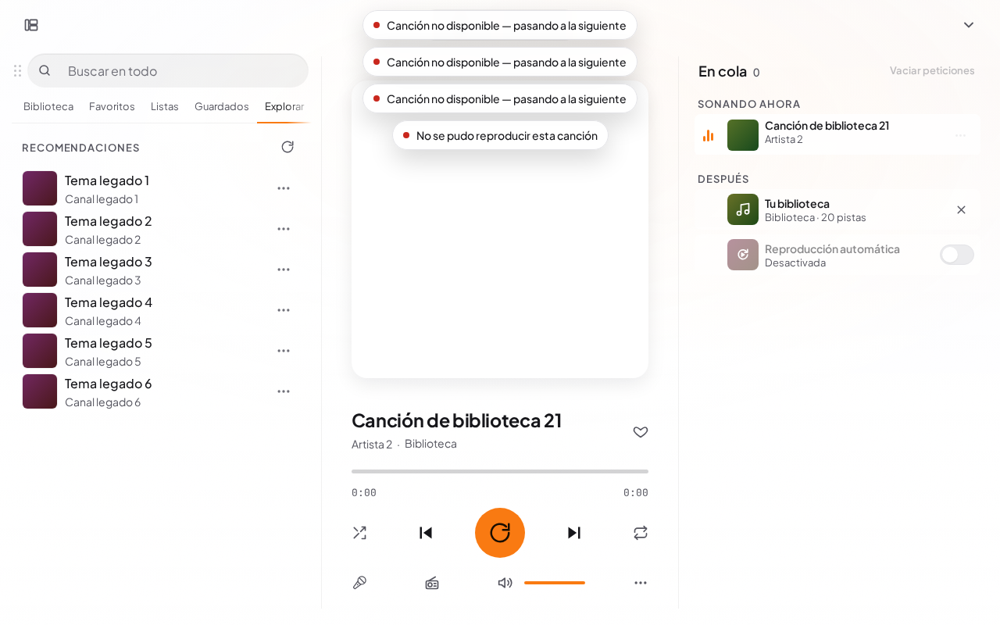
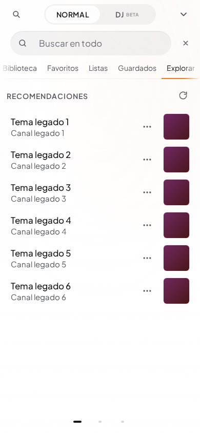
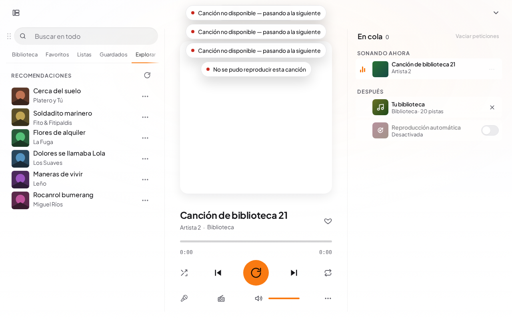
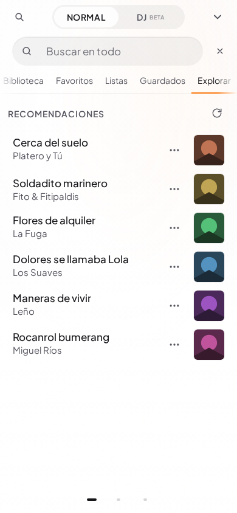

# Discovery Engine Unification (`D6`) Measurements

Captured on 2026-11-21 with a headless Chromium client against mocked `/api/*` endpoints (`lang=es`, `soundsible:interface-size=normal`) on `feat/unify-discovery-engines`.

## Before (`nodeDiscover.ts` + `/api/discover/feed`)

- Desktop (`desktop-explore-before.png`, 1280×800): 
- Mobile (`mobile-explore-before.png`, 390×844): 

In the baseline state, Now Playing `Explorar` ran a separate `nodeDiscover.ts` engine polling `GET /api/discover/feed` with weighted client seeds and `discover_seed_ready` socket pushes. Recommendations lacked catalog metadata/artwork (`channel`-only YouTube rows), recommendation reasons, `Not interested` feedback/Undo, and shared cache state with `/search` Discover.

## After (`discoveryFeedStore.ts` + `/api/discovery/music/feed`)

- Desktop (`desktop-explore-after.png`, 1280×800): 
- Mobile (`mobile-explore-after.png`, 390×844): 

Now Playing `Explorar` and `/search` Discover now consume one shared reactive store (`ui_web/src/lib/discoveryFeedStore.ts`) fed by `GET /api/discovery/music/feed` and `discovery_feed_ready` pushes. `Explorar` displays external-first round-robin catalog items with artwork, artist links, unified cache/refresh state, and row overflow actions (`Start radio`, recommendation `reason`, and `Not interested` + Undo synchronized immediately across both views).
