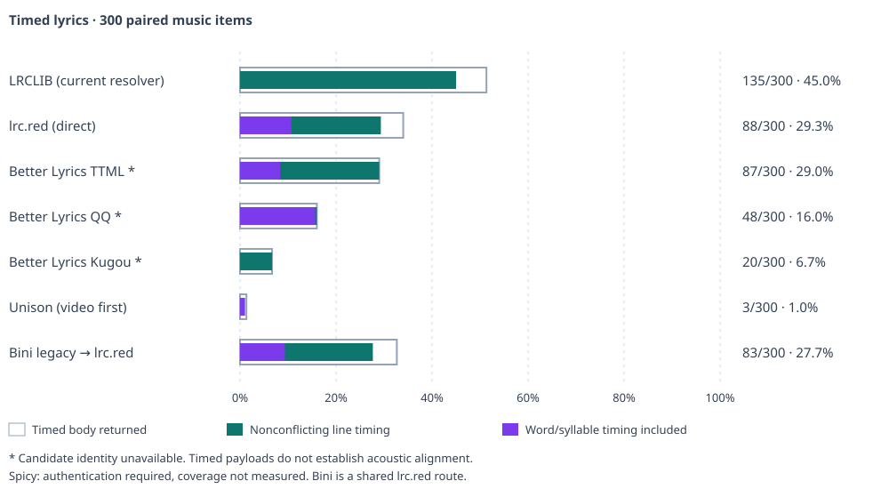

# Lyrics provider comparison on the owner's music collection

This is a request-level measurement, not a provider migration. It compares the
current LRCLIB resolver, direct lrc.red, the public Better Lyrics TTML / QQ /
Kugou endpoints, Unison, and the legacy BiniLyrics access route. Spicy Lyrics
access was checked separately. No audio was transcribed, played, or modified.

## Evidence and reproduction

All measurements use the same [300-item sample](lyrics-providers-2026-11-15/sample.json).
The [initial observations](lyrics-providers-2026-11-15/results.jsonl) retain HTTP
status, response digest and decoded size, cache/auth headers, time, parser
evidence, and candidate metadata. Complete lyric bodies are never written to
the repository. Account identifiers, tokens and local music paths are absent.

- [Runner](../../../scripts/benchmark_lyrics_providers.py)
- [Offline tests](../../../tests/test_lyrics_provider_benchmark.py)
- [Run configuration](lyrics-providers-2026-11-15/results.config.json)
- [Access checks and exclusions](lyrics-providers-2026-11-15/access.json)
- [Parser and Unison route rechecks](lyrics-providers-2026-11-15/validation.jsonl)
- [Derived summary](lyrics-providers-2026-11-15/summary.json)

The application baseline is merged `main` at
`f364bbdc3c89b20bc055ae000b74317bdda1fa41`. The benchmark imports its resolver,
including its real metadata normalization, confidence thresholds, short
429/503 retries, nine-second budget, and bounded Deezer metadata fallback.
It intercepts only that module's HTTP dependency to record and pace requests;
it does not instantiate the engine or any application database manager.

```sh
python scripts/benchmark_lyrics_providers.py snapshot \
  --database /path/to/your/library.db --limit 300 --output /tmp/sample.json

python scripts/benchmark_lyrics_providers.py run \
  --sample /tmp/sample.json --output /tmp/results.jsonl \
  --user-agent 'Your app (+https://your-project.example; contact@example.org)'

python scripts/benchmark_lyrics_providers.py validate \
  --sample /tmp/sample.json --results /tmp/results.jsonl \
  --output /tmp/validation.jsonl \
  --user-agent 'Your app (+https://your-project.example; contact@example.org)'

python scripts/benchmark_lyrics_providers.py summarize \
  --sample /tmp/sample.json --results /tmp/results.jsonl \
  --validation /tmp/validation.jsonl --output /tmp/summary.json
```

The checked-in sample can be reused without accessing any library database.
`run` and `validate` resume completed query keys; a different sample or run
configuration cannot silently reuse the initial run file. Reproduction makes
new network observations: public catalog, cache and authentication state can
change, so the archived observations are the evidence for this report.

## Population and sampling

A consistent SQLite read transaction, `mode=ro` and `PRAGMA query_only=ON`,
mirrors `CollectionStore.snapshot()` membership: files, saved items and playlist
members. File metadata takes precedence over the saved descriptor, as in the
application. The engine, its lyric cache and the user's audio remain untouched.

The snapshot has 499 owned items. Of these, 41 lack artist or title and cannot
use the current lyrics lookup contract. The eligible population is 458 music
items representing 265 literal artist labels. No podcast items were selected.
The deterministic sample covers 300 items (65.5% of the eligible population)
and 191 artist labels. It includes 210 file-backed items and 90 saved/playlist
items without files. There are 113 album-bearing items and four with an ISRC.

Selection is random within proportional strata of file/saved context, album
availability and ISRC availability. Largest-remainder allocation gives exactly
300 observations; the seed, stratum sizes and whole-population metadata digest
are in the manifest. Artist labels are not artist entities: uploader/channel
names and collaborations can give one performer several labels. The sample
represents this collection's metadata, not global music coverage.

All providers receive the same canonical artist/title and available album /
duration; missing metadata is not invented or borrowed from another provider.
The production LRCLIB path performs its own identical canonicalization.
Unison also receives the existing video/ISRC when available. Query order is
shuffled deterministically per item. Provider caches are not cleared or forced
to refresh, and repeated metadata tuples can hit an already warm cache.

## Routes and access

| Measurement | Access route | Interpretation |
| --- | --- | --- |
| LRCLIB | Production `shared/lyrics.py`, structured `/api/search`, optional Deezer metadata retry | Current behavior, including confidence-based misses. This is not a census of everything stored in LRCLIB. |
| lrc.red | Existing ISRC, or documented `/search.json`; then `/s/{isrc}.song.json` | The combined JSON provides original TTML in `source`, recording metadata and optional `byModel` in one download. Its payload can be larger than raw `.ttml`. Only the first search page is considered; pagination is recorded. |
| Better Lyrics TTML | `/getLyrics` | Public unauthenticated access, not the extension's privileged proxy. |
| Better Lyrics QQ | `/qq/getLyrics` | QRC, sometimes plain LRC / instrumental notices. Live authentication behavior takes precedence over the documentation. |
| Better Lyrics Kugou | `/kugou/getLyrics` | LRC. Live authentication behavior takes precedence over the documentation. |
| Unison | `/lyrics` with existing video ID and metadata | The normal video-first route, followed by a separately recorded metadata-only check for misses. |
| BiniLyrics legacy | `lyrics-api.binimum.org`, redirect to `lrc.red/api/v1`, then song JSON | Another access/search contract for lrc.red, **not an independent catalog**. The redirect adds a request. |
| Spicy Lyrics | Three unauthenticated `/v1/tracks/search` access probes | All returned 401. No project key was available. Catalog coverage is **not measured**, not zero. No borrowed extension key, registration, or authentication bypass was used. |

Each host has one in-flight request and at least 0.6 seconds between request
starts, with at most four item workers overall. Generic routes get a ten-second
read timeout and at most one retry for 429/503 when a numeric `Retry-After`
fits a three-second wait. Longer requested waits are not shortened into a retry.
There is no retry for 401/403/404. Responses are capped at 4 MiB decoded.
Every redirect, search, download, provider retry and Deezer call is counted.

The extension's native YouTube lyrics and captions are not standalone public
song-lyrics catalog APIs: they depend on YouTube Music page/player integrations.
Captions may be speech recognition rather than supplied karaoke timings. Their
coverage and transcription accuracy were not measured in this HTTP comparison.
Direct QQ/Kugou scraping and private Apple Music accounts were not substituted
for the public Better Lyrics routes.

## What the metrics mean

- **Returned timed**: the body actually contains line or segment timestamps.
  TTML with only paragraph timestamps is line sync. Word/syllable detail requires
  at least two distinct timed spans within a line, or actual QRC / enhanced-LRC
  segment timings. No word timings are interpolated. These two granularities
  are combined because not every source unambiguously distinguishes them.
- **Nonconflicting timed**: supplied timing with no explicit song/version or
  recording-length conflict. Unknown identity/duration is reported separately,
  not counted as independently verified. Instrumental notices are not lyrics.
- **Identity-screened timed**: nonconflicting timing plus a matching ISRC, or
  folded title similarity >= 0.80, artist similarity >= 0.72 and matching
  version tokens. This conservative screen can reject valid collaborations,
  classical performer credits or alternate spellings. Rejected search
  candidates are not downloaded; a rejection is not a catalog absence.
- **Duration conflict**: provider-reported recording duration differs by more
  than three seconds, or a timed line begins more than three seconds after the
  supplied audio duration. A shorter TTML document is not by itself a conflict:
  the audio can have an instrumental coda. Metadata durations are not acoustically
  verified and a similar duration cannot prove alignment.
- **Active latency**: measured lookup wall time minus the experiment's host
  queue/pacing. Provider retry waits remain included. This is a local observation,
  not an uptime or playback-latency promise. Median/p95 include unsuccessful
  lookups; a fast 401 is not a fast successful lyrics result.
- **CPU**: worker thread CPU, and separately local text parsing CPU. HTTP body
  sizes are decoded payload bytes, not wire bytes. XML/JSON parsing is measured;
  app rendering, animations, battery, memory peaks and audio alignment are not.
- **Fallback chains**: first-nonconflicting-timed unions and costs simulated from
  paired observations. Summed active times are simulated sequential costs,
  not a separately measured sequential request run. They stop at line timing;
  they do not exhaust all providers in search of richer timing.

The first pass retains its original parser/gate fields. Summary generation
recomputes timing eligibility from primitive metadata and timestamps, avoiding
the incorrect assumption that TTML document duration equals recording length.
QQ rechecks address literal XML attribute newline normalization and non-XML LRC
responses. A QQ parsing correction is applied only when its complete HTTP body
SHA-256 is identical; initial HTTP counts and latency remain unchanged. Rechecks
are archived separately and must not be mixed into first-pass latency.

## Results

The paired run ran on **15 November 2026, 13:49:06–13:58:30 UTC**, from the Linux host running the owner’s engine. It completed all **2,100 lookups** and made **2,724 external HTTP requests**, including 112 Deezer metadata calls and 300 Bini redirects. The additional validation ran 13:59:01–14:02:00 UTC and made 346 requests. The three Spicy access probes are separate. Exploratory controls are excluded from the matrix and latency statistics.



| Route | Returned timed | Nonconflicting timed | Identity-screened timed | Nonconflicting word/syllable | 401/403 |
| --- | ---: | ---: | ---: | ---: | ---: |
| LRCLIB, current resolver | 154/300 | 135/300 (45.0%) | 135/300 | 0/300 | 0 |
| lrc.red, direct | 102/300 | 88/300 (29.3%) | 88/300 | 32/300 | 0 |
| Better Lyrics TTML | 87/300 | 87/300 (29.0%) | 0/300 | 25/300 | 202 |
| Better Lyrics QQ | 48/300 | 48/300 (16.0%) | 0/300 | 47/300 | 228 |
| Better Lyrics Kugou | 20/300 | 20/300 (6.7%) | 0/300 | 0/300 | 237 |
| Unison, video-first | 4/300 | 3/300 (1.0%) | 3/300 | 3/300 | 0 |
| Bini legacy → lrc.red | 98/300 | 83/300 (27.7%) | 83/300 | 28/300 | 0 |

Better Lyrics’ identity-screened column is zero because the benchmark does not independently screen candidate recording identity from those lyric-only responses. This is **missing evidence**, not evidence that every returned lyric is wrong. Embedded lyric credits are not treated as independent catalog identity.

The QQ recheck kept 50 identical response digests. It resolved two first-pass format failures (an instrumental LRC notice and ordinary LRC), and reconstructed line boundaries in 47 QRC bodies after XML attribute whitespace normalization. One QRC response (`m0265`) remains invalid under strict XML parsing; this is reported as a format/contract error, not a missing song. The renderer/parser used by another client may tolerate that wrapper. The original network observations and original parse CPU remain archived.

Unison’s metadata-only fallback was checked on all 296 video-route misses. It added two nonconflicting word-timed results, both already covered by LRCLIB. The combined video-then-metadata strategy therefore finds five nonconflicting timed results on this sample; its extra requests are not hidden in the video-only row above.

**Source quality matters:** eight of lrc.red’s 32 nonconflicting word/syllable results carry `byModel=true`. Excluding that flag leaves 24; an absent flag does not certify manual or official timing. Bini’s route exposes six flagged results in its 28. The Better Lyrics backend’s source has a default filter for model-synced lrc.red files, so its lower returned count cannot be interpreted solely as a smaller catalog.

### Latency, request count and local CPU

| Route | HTTP requests / lookup | Active p50 / p95 (ms) | Decoded body total (MiB) | Parse CPU p50 / p95 (ms) |
| --- | ---: | ---: | ---: | ---: |
| LRCLIB, current resolver | 1.38 | 181.5 / 347.4 | 21.17 | 0.373 / 0.732 |
| lrc.red, direct | 1.35 | 105.5 / 201.5 | 4.21 | 0.673 / 3.074 |
| Better Lyrics TTML | 1.00 | 105.0 / 132.9 | 1.03 | 0.571 / 2.179 |
| Better Lyrics QQ | 1.00 | 104.2 / 133.5 | 0.29 | 0.550 / 1.097 |
| Better Lyrics Kugou | 1.00 | 103.1 / 136.9 | 0.06 | 0.393 / 0.552 |
| Unison, video-first | 1.00 | 226.3 / 323.6 | 0.13 | 1.311 / 3.224 |
| Bini legacy → lrc.red | 2.35 | 152.7 / 255.6 | 4.04 | 0.646 / 2.882 |

These timings include misses and access denials. **There were no observed 429, 503, network timeout or transport errors in the principal run**; this short, warm-cache-heavy observation does not establish long-term availability. QQ parser CPU describes the first-pass parser, not corrected QRC parsing; validation CPU is retained separately. lrc.red’s song JSON carries original TTML plus structured data, whereas the Better Lyrics responses carry a smaller lyric body. The CPU figures support low parsing cost on this host, not zero cost or a conclusion about mobile rendering.

### Metadata and source context

| Route | File-backed items (n=210) | Saved/playlist items (n=90) | No album (n=187) | Album present (n=113) |
| --- | ---: | ---: | ---: | ---: |
| LRCLIB, current resolver | 95 | 40 | 65 | 70 |
| lrc.red, direct | 64 | 24 | 39 | 49 |
| Better Lyrics TTML | 65 | 22 | 30 | 57 |
| Better Lyrics QQ | 32 | 16 | 21 | 27 |
| Better Lyrics Kugou | 14 | 6 | 9 | 11 |
| Unison, video-first | 2 | 1 | 1 | 2 |
| Bini legacy → lrc.red | 61 | 22 | 39 | 44 |

No exact canonical artist/title/album/duration tuples repeat in the sample; every item has a supplied duration and video ID. Only four have an ISRC, so the one-request direct-ISRC advantage has a very small applicable cohort here. Twelve lrc.red searches expose a next page; this benchmark deliberately bounds search to one page. Album availability is observational, not randomized: this table does not prove that adding an album causes the difference.

### Simulated first-timed fallback strategies

| Order | Timed union | Word/syllable selected | Mean HTTP requests | Simulated active p50 / p95 (ms) |
| --- | ---: | ---: | ---: | ---: |
| lrc.red → LRCLIB | 146/300 | 32/300 | 2.44 | 268.6 / 458.7 |
| LRCLIB → lrc.red | 146/300 | 0/300 | 2.00 | 236.3 / 458.7 |
| Better Lyrics TTML → LRCLIB | 141/300 | 25/300 | 2.09 | 282.0 / 455.3 |
| Unison → lrc.red → LRCLIB | 146/300 | 32/300 | 3.42 | 529.9 / 737.1 |
| lrc.red → Better Lyrics TTML → Better Lyrics QQ → Better Lyrics Kugou → Unison → LRCLIB | 148/300 | 39/300 | 4.91 | 834.8 / 1052.2 |

All 32 nonconflicting lrc.red word/syllable items already have accepted line timing in LRCLIB. Thus **LRCLIB-first, stopping at the first timed result, adds no word timing** in this sample. lrc.red-first selects richer timing on those 32 items, including the eight model-flagged ones. Looking for richer timing after an LRCLIB hit is a different product policy and adds work; it is not represented by a first-hit fallback.

### Recommendation

**Retain LRCLIB as the broad baseline; do not replace it with lrc.red alone on the strength of this sample.** The production resolver returned 154 timed results; 135 pass the comparison’s stricter song/recording screen. lrc.red returned 102 timed results; 88 pass. Its useful additions are 11 songs beyond that LRCLIB screened set and optional word/syllable detail on songs LRCLIB already covers.

If the objective is more songs with automatic line sync, LRCLIB → lrc.red reaches the same 146-item screened union with fewer requests than the reverse order (2.00 versus 2.44 per item in the simulation). If word/syllable presentation is the objective, test an explicit enrichment policy with a source-quality rule; eight returned rich timings are model-flagged, and no acoustic alignment has been established here.

The longer six-route chain adds only two screened results beyond the 146-item lrc.red/LRCLIB union while nearly doubling simulated request cost (4.91 versus 2.44). Its opaque candidate identity is an additional unresolved quality limit. Better Lyrics public access is currently unsuitable as the only source because 202/300 TTML queries, 228/300 QQ queries and 237/300 Kugou queries were denied. Those are access gaps, not proven catalog gaps. Bini is a shared lrc.red access route with an extra redirect, and Unison has little incremental coverage for this collection. Spicy remains unevaluated for coverage without a project-owned key.

No provider was enabled or changed in Soundsible. A product integration should have separate acceptance for wrong versions, music-video intros, source attribution, caching and actual client rendering. These measurements do not certify voice-level synchronization.

## Follow-up: the LRCLIB → lrc.red integration

The recommendation is implemented as resolver `v6` in `shared/lyrics.py`. LRCLIB
is asked as before. lrc.red is asked once when LRCLIB's answer has no timed
lines that fit the recording: nothing found, plain text only, an instrumental
flag, lines timed against another length (or starting after the audio ends),
or an LRCLIB error. lrc.red's candidate must pass this report's identity screen
(title ≥ 0.80, artist ≥ 0.72, same version tokens), have no known duration
mismatch beyond three seconds, and not be `byModel`. Unknown length is not
evidence of a mismatch; a line starting after the audio ends is rejected.
Its enhanced LRC is reduced to line
LRC, and its lines are credited with a link wherever the player shows them.

The classification above explains why the trigger is "no fitting timing" and
not "no answer". Of lrc.red's 11 screened additions over LRCLIB, LRCLIB
answered 10: five with lines timed for another length, four with plain text
only, one flagged instrumental. Only one was a plain miss.

[`resolver-integration.jsonl`](lyrics-providers-2026-11-15/resolver-integration.jsonl)
is that resolver run live over the same 300 items on 15 November 2026,
16:10–16:25 UTC, two lookups at a time, recording only the sample id, who
answered, whether the timed lines fit, and request counts per host:

| | Items |
| --- | ---: |
| Timed lines that fit, from LRCLIB | 144 |
| Timed lines that fit, from lrc.red | 9 |
| LRCLIB text without fitting timing, lrc.red had nothing usable | 39 |
| Nothing from either | 108 |
| Provider errors | 0 |

LRCLIB alone would have served the same 144: lrc.red is asked only after
LRCLIB's answer did not fit. lrc.red therefore takes timed lines from 144 to
153 (48.0% → 51.0%) at 0.56 extra requests per lookup (168 in all). Nine of
the eleven additions above came back. The other two (`m0038`, `m0134`) carry
LRCLIB lines whose length LRCLIB does not agree on; the production rule treats
an unknown length as no evidence of a mismatch, so they count as fitting and
lrc.red is not asked. The 144 differs from the 135 above for the same reason:
this report's screen read a lone upload's length where production does not.

The shared web and Android lyrics panel names lrc.red with a link when it
supplies the lines. Subsonic excludes those records because its lyrics
responses cannot carry that attribution. The client identification uses the
project link and the existing public contact from `SECURITY.md`.

## Source contracts checked

- [lrc.red API and attribution / client identification requirements](https://lrc.red/api).
  lrc.red is credited here; no lyric text is republished. The site's current
  notice acknowledges recent saturation and an infrastructure migration.
- [Better Lyrics authentication](https://docs.betterlyrics.org/docs/authentication)
  and [provider endpoints](https://docs.betterlyrics.org/reference/get-lyrics).
  Missing album/duration may miss a cache key even for a cached song. In this
  run, QQ/Kugou also require a key on uncached queries despite their docs saying
  they never require one; the observed status and auth headers are preserved.
- [Better Lyrics API source](https://github.com/better-lyrics/api/tree/af052f092776a0225b992383760fcdbc9e23db51):
  cache -> lrc.red by ISRC -> Apple upstream. Shared upstream means these are not
  independent failure domains or independent coverage sources.
- [Extension provider and auth flow](https://github.com/better-lyrics/better-lyrics/blob/cfe9b06ee4e068bc2c4b931463edd94edc9c0090/src/modules/lyrics/providers/unified.ts).
  Its Turnstile/JWT proxy is not the public API measured here.
- [Unison public lookup and attribution](https://docs.betterlyrics.org/unison).
  No submitter/identity account was created or used by the study.
- [BiniLyrics client source](https://github.com/binimum/am-lyrics/blob/7562eaba685d8952491fb6b7af9702e13de900bb/src/AmLyrics.ts).
- [Spicy Lyrics keys](https://developers.spicylyrics.org/docs/keys) and
  [track search contract](https://developers.spicylyrics.org/docs/reference/search.tracks).
