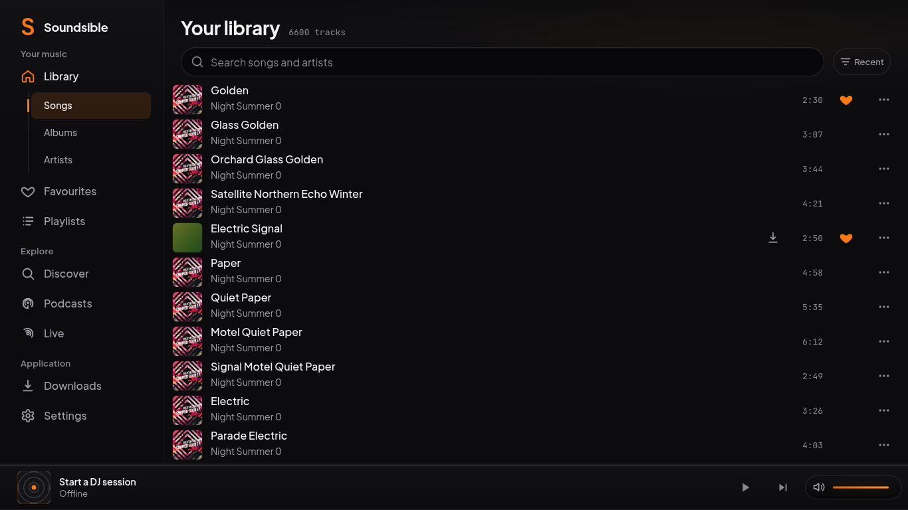
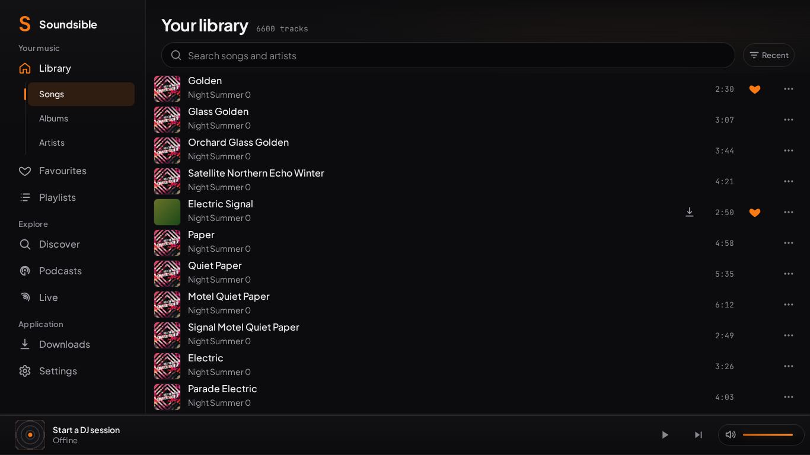
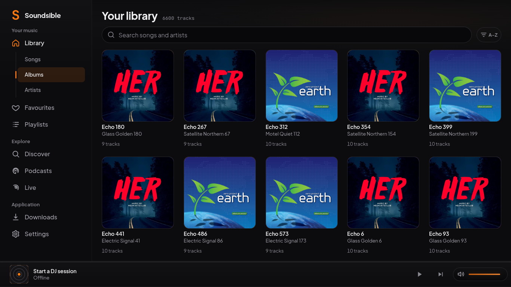
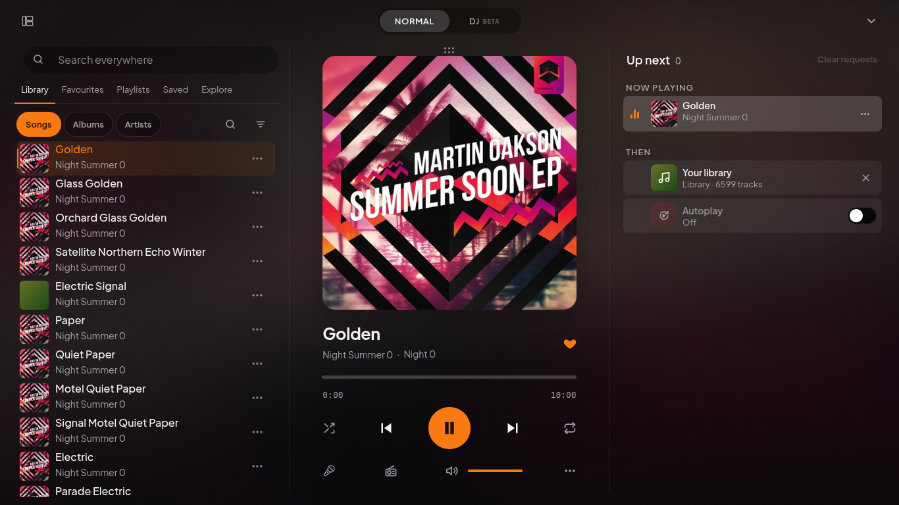
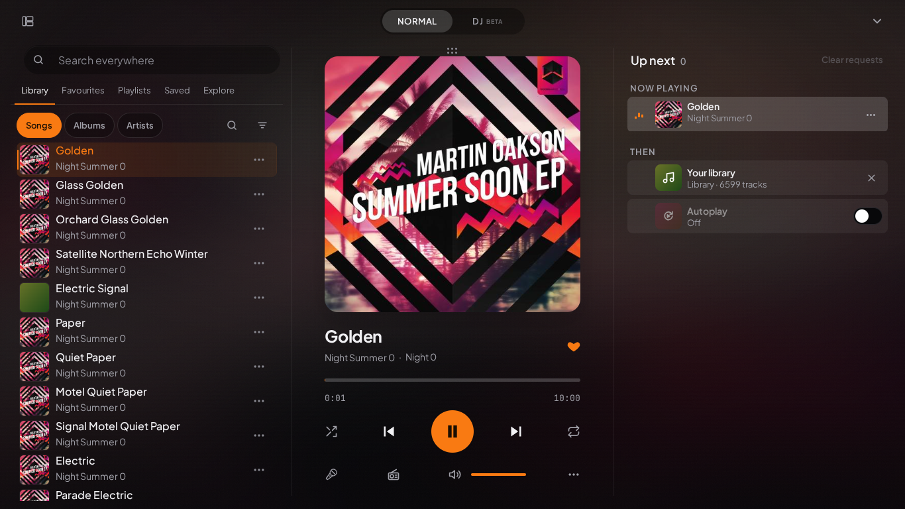
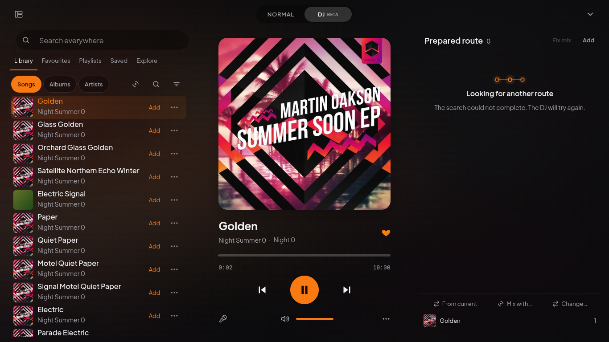
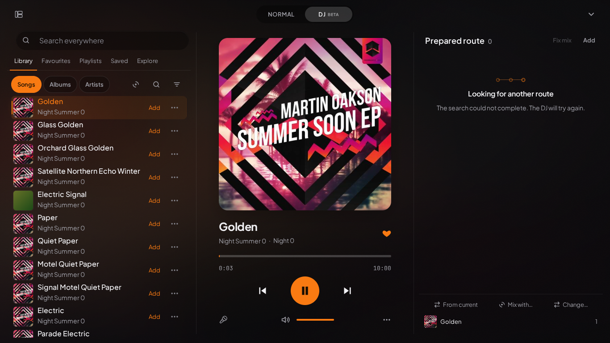

# ThinkPad X270 Web UI Rendering & Scroll Overhaul (2026-11-20)

Direct physical-hardware investigation, architectural remediation, and verification on the owner's ThinkPad X270 (`Intel Core i5-6300U @ 2.40GHz`, 4 logical cores, integrated `ANGLE (Intel, Mesa Intel(R) HD Graphics 520 (SKL GT2), OpenGL ES 3.2)`, `1920x1080`, hardware Chromium `156.0.8078.4`).

## Root Causes Diagnosed

1. **Row artwork rendering (`` vs CSS background gradients)**:
   - List and player-browser artwork previously relied on per-cell CSS backgrounds or 8-property inline style spreads, forcing style recalculations on recycle and lacking frame-budgeted decoding during fast trackpad flings.
   - Importing `ScrollActivityContext` from `CollectionView.tsx` into `Artwork.tsx` and `ArtworkImage.tsx` also statically pulled `CollectionView` and `@tanstack/solid-virtual` into the initial `library` payload closure (`+9,742` gzip bytes, pushing it to `225,360` B vs the `215,316` B ceiling).
2. **Collection windowing & layout churn**:
   - Unquantized per-pixel range updates and per-scroll `rAF` + `offsetHeight` reads in `CollectionGrid` re-triggered layout and `getBoundingClientRect` during scroll.
   - Eager `SavedEntry` allocations in `SongRow`, unmemoized `performerNames` arrays in `ArtistLinks`, and spreading/allocating props in `NowPlayingBrowser` (`autoRow`) added per-recycle script cost.
   - Reactive `scroll` updates in `musicBrowserNavigation` notified listeners on every browser scroll event.
3. **Player surface transition & DJ surface paint/compositing**:
   - Closing `#app` behind `PlayerSurface` used `blur(16px)` and `scale(0.96)`, causing full-tree filter and transform passes across the shell.
   - `PlayerSurface` opened simultaneously with all three internal panels mounting together and eagerly read `desktopQueueEl.scrollTop = 0`.
   - `AutoMode` loading spinner (`routeLoadingStep`) animated non-composited `border-color` and `box-shadow`, and `ArtworkBackdrop` rasterized its blur at full viewport dimensions rather than a bounded offscreen edge.

## Architectural Fixes

- **Artwork & shared scroll activity (`ui_web/src/lib/artworkSlot.ts`, `artworkHints.ts`, `media.ts`, `design/Artwork.tsx`, `Artwork.module.css`, `ArtworkImage.tsx`, `PlayerTrackList.tsx`)**:
  - Moved `ScrollActivityContext` into `lib/artworkSlot.ts` and shared `createScrollDeferred` in `lib/artworkHints.ts` so `Artwork` stays decoupled from `CollectionView`/`@tanstack/solid-virtual`.
  - Refactored `ArtworkSurface` to render a persistent async-decoded `` inside a `contain: layout paint style` ``, setting inline gradient `style` only when `artworkUrl` is absent or fails, and rate-limiting uncached reveals (`FRAME_ARTWORK_BUDGET = 6` per `requestAnimationFrame`) via a bounded 512-entry `paintedSources` LRU.
  - Added bounded 2,048-entry `coverUrlCache` / `candidatesCache` in `lib/media.ts`.
- **Virtualization & row recycling (`ui_web/src/components/CollectionView.tsx`, `CollectionView.module.css`, `CollectionGrid.tsx`, `AlbumGrid.tsx`, `ArtistGrid.tsx`, `SongRow.tsx`, `SongRow.module.css`, `MusicLinks.tsx`, `CollectionButton.tsx`, `FavouriteButton.tsx`, `Library.module.css`, `TrackList.module.css`)**:
  - Replaced virtualizer `onChange` polling with passive `createScrollSettled` tracking velocity flings (`> 1.5 px/ms`) and applied quantized `rangeExtractor` windows (`step` 4/8 in rows, `step` 2 in grids).
  - Removed `CollectionGrid`'s scroll-frame `rAF`/`offsetHeight` loop, guarded `onLayout` by width change only, and removed `keyed` re-creation in `AlbumGrid`/`ArtistGrid`.
  - Passed reactive `keys` and lazy `resolveEntry` in `SongRow` to avoid eager `SavedEntry` allocations, memoized multi-artist `ArtistLinks`, and removed hover transforms/drop shadows from dense rows.
- **Player & DJ surfaces (`ui_web/src/app.tsx`, `styles/app.css`, `PlayerSurface.tsx`, `PlayerSurface.module.css`, `NowPlaying.tsx`, `AutoMode.tsx`, `AutoMode.module.css`, `NowPlayingBrowser.tsx`, `NowPlayingBrowser.module.css`, `musicBrowserNavigation.ts`, `ArtworkBackdrop.tsx`, `activityMemo.ts`)**:
  - Dynamically loaded `PlayerSurface` on `Shell` mount (`app.tsx`), bringing initial authenticated `library` closure cleanly below budget without removing lazy first-load recovery for `playerViews` (`NowPlaying`/`AutoMode`).
  - Removed `#app` `blur(16px)`/`scale(0.96)`, staggered desktop panel mounts (`queue`/`route` -> `browser`) across frames after `PlayerSurface` settles, deferred queue scroll reset until offscreen close, paused decorative animations when hidden (`--decorative-animation-state: paused`), promoted `will-change: transform` only during surface transitions, capped `ArtworkBackdrop` rasterization to `240px` max edge with `0x0` unpainted `<canvas>` defaults, and replaced `AutoMode` box-shadow keyframes with compositor-only opacity/transform.

## Hardware Measurements (ThinkPad X270, 1920x1080, 1x CPU, Hardware ANGLE)

Commands run on clean mock data (`ui_web/perf/bench.mjs`, `REPEATS=3 SIZE=1920x1080 RATES=1`):

| Surface | CPU | Complete / expected | Partial / dropped | Display gap p50 / p95 / max, ms | Longest task, ms | Script / layout / paint, ms | Busy: main / compositor / GPU / display, ms |
| --- | --- | ---: | ---: | ---: | ---: | ---: | ---: |
| songs (before) | 1× | 186/286 | 92/8 | 13.6 / 24.8 / 34.1 | 50.6 | 388.1 / 534.2 / 887.8 | 3002.6 / 791.3 / 3304.5 / 156 |
| songs (after) | 1× | 198/209 | 11/0 | 16.6 / 22.3 / 27.2 | 33.9 | 399.7 / 237.5 / 480.3 | 1571.9 / 331.8 / 2069 / 134.7 |
| albums (before) | 1× | 48/149 | 90/11 | 16.7 / 64.8 / 127.2 | 81.5 | 923.8 / 652.3 / 424.4 | 2912.4 / 364.4 / 1792.2 / 106.2 |
| albums (after) | 1× | 148/227 | 77/2 | 13 / 23.2 / 34.4 | 63.5 | 381.6 / 391.8 / 329.1 | 1435 / 222.8 / 1962.8 / 106.8 |
| player-browser (before) | 1× | 101/214 | 97/16 | 16.7 / 33.3 / 47 | 53.7 | 469.3 / 525.2 / 664.5 | 2893.6 / 657.1 / 2920.9 / 115.5 |
| player-browser (after) | 1× | 109/168 | 58/1 | 20.9 / 35.6 / 80.1 | 34.6 | 359.8 / 209.5 / 454.5 | 1763 / 426.6 / 2065.6 / 110.9 |
| player-queue (before) | 1× | 75/125 | 49/1 | 17.8 / 27.9 / 42.9 | 33.3 | 250.6 / 162.1 / 348.9 | 1163.1 / 259.1 / 1365.1 / 66.2 |
| player-queue (after) | 1× | 67/110 | 43/0 | 19.6 / 30 / 42.4 | 45.1 | 222.4 / 146.8 / 518.4 | 1335.6 / 305 / 1256.8 / 67.2 |

### Extra Surfaces (`player-open`, `dj-browser`, `dj-idle`, 1920x1080, 1x CPU)

Initial `EXTRA_SURFACES` measurement (before reverting `OmniSeek` `!nowPlayingOpen()` and idle `playerViews` preload):

| Surface | CPU | Complete / expected | Partial / dropped | Display gap p50 / p95 / max, ms | Longest task, ms | Script / layout / paint, ms | Busy: main / compositor / GPU / display, ms |
| --- | --- | ---: | ---: | ---: | ---: | ---: | ---: |
| player-open | 1× | 85/126 | 23/18 | 16.6 / 31 / 334.1 | 77.1 | 208.3 / 295 / 250.2 | 1080.5 / 280.9 / 977.2 / 91.8 |
| dj-browser | 1× | 192/256 | 62/2 | 14.3 / 25.5 / 32.2 | 60.2 | 430.9 / 293.5 / 645.8 | 2175 / 576.5 / 2692.8 / 159.1 |
| dj-idle | 1× | 202/202 | 0/0 | 16.7 / 19.8 / 70.2 | 13.8 | 25.9 / 12.5 / 9.8 | 133.9 / 396.3 / 2453 / 329 |

Final `EXTRA_SURFACES` re-measurement on the committed architecture (on-demand `playerViews` import preserved):

| Surface | CPU | Complete / expected | Partial / dropped | Display gap p50 / p95 / max, ms | Longest task, ms | Script / layout / paint, ms | Busy: main / compositor / GPU / display, ms |
| --- | --- | ---: | ---: | ---: | ---: | ---: | ---: |
| player-open | 1× | 102/181 | 51/28 | 15.1 / 28.4 / 336.4 | 98.3 | 320.9 / 364.6 / 326.5 | 1405.8 / 386.3 / 1267.9 / 131.5 |
| dj-idle | 1× | 202/202 | 0/0 | 16.7 / 22.1 / 67.2 | 14.3 | 30.4 / 11.8 / 7.3 | 139.3 / 498.8 / 2635.8 / 391.5 |

## Steady-State `MutationObserver` & Payload Checks (Final Bundle)

- **Mid-list scroll `MutationObserver` on `[data-collection-rows]` (`1920x1080`, 20 wheel ticks `deltaY: 120` @ 16ms + 350ms settle)**:
  - Active scroll phase (`during`): `childList: 7`, `addedDivs: 0`, `removedDivs: 0`, `spanStyle: 7` (only from missing-artwork fixture rows toggling seeded gradient styles).
  - Post-scroll settle phase (`settle`): `childList: 70`, `addedDivs: 48`, `removedDivs: 56`, `spanStyle: 0` (expected reorder and parking trim from `56 -> 48` slots once scrolling stops).
- **Initial payload closure (`check-payload.mjs` rules against `250,368` B gzip baseline)**:
  - `login`: `219,398` raw / `84,420` gzip / `79,659` brotli (`66.28%` gzip reduction, limit `125,184` B).
  - `library`: `612,702` raw / `206,915` gzip / `195,725` brotli (`17.36%` gzip reduction, `8,401` B below `215,316` B limit; `origin/main` was `214,666` B gzip).

## Validation Run Locally

- `npm test` (`ui_web`): `tsc --noEmit` (0 errors), `design:check` (3/3 passed, within baseline), `vitest run` (`243` files, `2,056` tests passed), `node --test perf/*.test.mjs` (`7/7` passed).
- `npx playwright test --project=chromium-mobile --project=chromium-desktop`: `458` passed, `78` skipped (viewport/engine/production-only skips), `0` failed.
- WebKit and Firefox Playwright suites run in GitHub Actions `ui_accessibility` (Docker/WebKit system libraries are not installed on this host).

## Visual Artifacts (`1366x768`, dark mode)

| View | Before | After |
| --- | --- | --- |
| Songs |  |  |
| Albums |  |  |
| Now Playing |  |  |
| DJ Mode |  |  |

- Motion capture covering Songs/Albums scrolling, PlayerSurface open/close, and DJ browser scrolling: [motion-scroll-and-player.webm](motion-scroll-and-player.webm).
