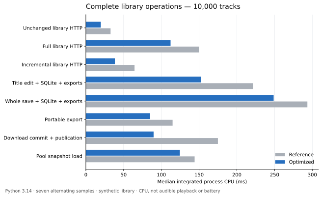

# Measured library and runtime optimizations

Reference: merged `main` at `3c7e4af39a523141de21f14f3891e935728bc864`.
The acceptance rule for this pass is a demonstrated improvement over 0.5% in
an end-to-end metric, or a demonstrated functional/reliability improvement.
Small improvements qualify. Timing a helper alone is not acceptance evidence.

## Implemented

- Public fingerprints use C attribute/item getters with the identical field
  order and pickle bytes. Every mutable-model verification still runs; an
  unsaved edit never becomes trusted just because SQLite's revision matches.
- Track construction reuses its dataclass field set; public copies reuse field
  names and shallow-copy lists consisting entirely of immutable strings.
  Subclasses and other mutable values retain the general path. Copies remain
  detached, and private scan paths remain excluded.
- Portable JSON selects the measured encoder for its interpreter: the flat
  scalar/string-list path on Python before 3.13, the standard indented C encoder
  on newer Python. Both produce identical bytes, including extended/nested
  values. Only schema-key prefixes are cached, bounded to 128 names.
- Explicit metadata edits verify the pre-edit and reconstructed candidate
  against the canonical fingerprint, then update only the changed public row
  hash. They no longer select and hash all stored public rows. Undeclared
  mutations, reordering, revision conflicts and projection failures roll back.
  Search/catalog maintenance and complete portable exports retain their contracts.
- ODST hashes the exact platform-newline bytes as it writes them, eliminating
  its post-publication reread. A download commit reuses the revision checked
  under its publication lock instead of hashing that same input twice.
- A successful ODST publication retains a digest and the byte offset of the
  final podcast fields, never a second podcast/library snapshot. On a later
  save, a complete matching file digest permits reading only that suffix.
  Foreign files, restarts, invalid models and changed digests use the full
  validating reader. Publication failures retain the previous tokens. Music
  libraries with empty podcast fields benefit too. Serialization and one
  full content-hash read remain proportional to library size.
- Local search uses SHA-256 for its proof instead of BLAKE2b. Its persisted
  format token explicitly changes; the same folded rows are checked and
  rehashed once, without refolding. Matching, ranking and candidate SQL do not
  change. Other format/interpreter/Unicode changes still rebuild the index.
- The shell freshness check uses one scandir/stat pass and a small on-disk
  input manifest. After a successful build, deletion, renaming, old-timestamp
  additions and size changes invalidate the bundle. An edit during a build is
  detected on the next render. Existing bundles without a manifest retain the
  legacy mtime fallback until their next build. No source observer or background
  thread is introduced; automatic building, external bundles and skip flags work
  as before. Same-size edits with deliberately restored timestamps are not
  content-hashed.
- Artwork keeps at most 256 names/deadlines, with no image data or open handles.
  A recent hit checks the index file identity/timestamps, absence of a journal,
  current quota and bookkeeping symlinks before bypassing SQLite/locking. Any
  other writer, expiration, quota change or interrupted publication restores
  the coordinated path. Each response opens and owns its descriptor. Originals,
  quota reconciliation, eviction and at-most-once-per-minute LRU updates remain.

## Reproduction and evidence

All fixtures use disposable directories. No production service, user library,
installed sidecar or remote provider is modified. Do not run concurrent test
suites/builds during measurements.

```sh
venv/bin/python scripts/benchmark_runtime_optimizations.py \
  --sizes 200 1000 10000 50000 --repeats 7 \
  --output docs/performance/runtime-optimizations.jsonl
venv/bin/python scripts/benchmark_runtime_candidates.py \
  --output docs/performance/runtime-candidates.jsonl
```

The library harness alternates historical/current operations, including real
SQLite, durable portable exports and Flask responses. Only core lookup is bound
to the synthetic library; artwork/loudness stores and the routes are real.
Every exported copy must equal the public JSON, every delta must contain its
edit, and every response must satisfy its expected status/content. Historical
methods are compiled from git against the current harness; this is a comparison
of those operations, not a boot of an old application checkout.

Wall time and integrated process CPU are recorded independently. Small-library
durable writes are dominated by variable physical fsync latency; CPU reduction
does not imply lower median wall time in every sample. Loaded models, native
SQLite allocations and other processes are outside the CPU/allocation scope.

The candidate harness serves a shell fixture with the repository's real input
file names, local-search results through the actual SQLite selector/ranker and
JSON transport, and 50 different generated covers through the production cover
route. These are complete server operations, not browser render/battery or
audible-playback measurements.

The raw full-operation matrix is in [runtime-optimizations.jsonl](runtime-optimizations.jsonl).
It precedes the final interpreter-specific JSON extension; the final complete
three-copy export is measured separately in
[Python 3.12](portable-encoder-py312.jsonl) and
[Python 3.14](portable-encoder-py314.jsonl). Each file records interpreter and
source hashes. The additional encoder comparison uses the production model and
atomic-file helpers, excluding SQLite and provider objects.

Seven alternating samples per operation, 10,000 tracks, milliseconds:



| Complete operation | Reference wall | Current wall | Process CPU reduction |
| --- | ---: | ---: | ---: |
| HTTP unchanged library | 32.82 | 19.85 | 39.5% |
| HTTP full library | 150.12 | 112.50 | 25.1% |
| HTTP incremental library | 137.36 | 105.21 | 40.4% |
| Title edit, SQLite + two exports | 414.23 | 339.65 | 31.1% |
| Whole canonical save + two exports | 494.16 | 464.70 | 15.2% |
| Portable export | 339.89 | 283.22 | 25.9% |
| Download commit + podcast preservation + publication | 280.57 | 197.43 | 48.7% |
| Pool snapshot load | 144.39 | 124.77 | 13.6% |

At 50,000 tracks, unchanged HTTP goes from 164.16 to 94.93 ms; complete title
edits from 1,925.71 to 1,503.55 ms; download commits from 1,283.96 to 887.32 ms.
At 200 tracks CPU reductions range from 9.9% to 42.7%, but noisy fsync-dominated
wall time includes regressions (download commit 35.50 to 38.76 ms and delta
55.30 to 58.67 ms). No universal latency improvement is claimed.

After the final encoder integration and nullable-row proof repair, a
[fresh integration run](runtime-final-integration.jsonl) repeats complete edits,
exports and download commits at 10,000 tracks. Respectively, wall time is
444.45→361.19, 320.67→285.68 and 274.16→187.91 ms; integrated CPU is
238.85→164.91, 123.09→88.34 and 182.97→94.01 ms. These samples have their own
source hashes; they are not mixed into the earlier matrix's medians.

Additional complete operations, [raw samples](runtime-candidates.jsonl):

| Operation | Reference median | Current median |
| --- | ---: | ---: |
| Shell HTTP request, 693 input files (31 samples) | 2.88 ms | 1.79 ms |
| Local search HTTP, 50k tracks, `song 4242` (15 samples) | 25.33 ms | 24.06 ms |
| Local search HTTP, 50k tracks, absent query (15 samples) | 21.37 ms | 20.14 ms |
| Local search HTTP, 50k tracks, dense `so` (15 samples) | 113.52 ms | 112.29 ms |
| Digest migration, 50k tracks (5 samples) | 909.49 ms refold | 116.59 ms rehash |
| 50 distinct covers through production HTTP route (15 samples) | 82.79 ms | 76.15 ms |

The shell regression fixtures also demonstrate detection of five changes the
mtime-only path missed: deletion, renaming, an old-timestamp addition, a size
change with the original timestamp, and removal of a public asset. A separate
fixture changes a source during the build and verifies it remains stale.

The final encoder comparison publishes three durable copies, seven alternating
samples. At 50,000 tracks Python 3.12 uses 476.67 ms process CPU with the flat
encoder versus 704.21 ms with the standard encoder (32.3% reduction); wall time
is 1,583.18 versus 1,866.50 ms. Python 3.14 uses 411.81 ms CPU with its standard
encoder versus 570.44 ms with the flat encoder. The runtime selects the better
path; this is why the unconditional prototype was not retained.

Reproduce that comparison with either interpreter:

```sh
python3.12 scripts/benchmark_portable_encoder.py --repeats 7 \
  --output /tmp/portable-encoder-py312.jsonl
venv/bin/python scripts/benchmark_portable_encoder.py --repeats 7 \
  --output /tmp/portable-encoder-py314.jsonl
```

## Candidates without an accepted change

- An unconditional manual pretty-JSON encoder regressed on Python 3.14. It
  was removed from that runtime. The desktop ships Python 3.12, so that decision
  was also tested there before closing it. The final scalar/string-list encoder
  is restricted to older Python; final interpreter comparisons are linked above.
- Further export batching would change the existing synchronous publication
  contract for external consumers. Existing lifecycle callbacks already
  coalesce repeated exports within one coordinated operation. This pass keeps
  every completed operation's portable state available on return.
- Dropping full-model fingerprints based only on a database revision would
  accept unsaved mutations through the existing public mutable-model API.
  Regression tests reproduce this failure for scalar fields, nested values,
  headers and ordering. The accepted changes speed those proofs and remove
  redundant SQL work while keeping the checks.
- The historical DJ priority proposal predates merged P14. Current session
  work already has bounded executors, removable interests and cancellation of
  obsolete queued/running work. This pass does not introduce another scheduler
  or change audio/transition policy without evidence for a new benefit.

## Concurrent transport

[Raw load cases](runtime-load.jsonl) use the production Range handler while real
metadata edits, exports and a paced filesystem scan compete on 10,000 tracks.
There are 2,388 verified responses across nine completed cases and zero returned
status/content errors. The `ssd`/`hdd` names select the existing worker-count
profiles; both use the same repository storage, not different physical devices.

Three alternating pairs, two clients, twelve seconds of offered work per run:

| Metric, median across runs (`ssd` profile) | Reference | Current |
| --- | ---: | ---: |
| Event-loop lag p95 | 199.99 ms | 133.09 ms |
| Range response p95 | 3.38 ms | 2.97 ms |
| Completed Range responses | 271 | 321 |

The single `hdd` pair improves hub p95 from 341.50 to 296.36 ms and completed
requests from 195 to 215, but Range p95 increases from 7.71 to 10.97 ms. That
pair is a correctness/load case, not evidence of universal latency reduction.
One earlier harness invocation terminated with exit 143 and no diagnostic
output. It is retained as an interrupted attempt in the JSONL; the independent
replacement case completed correctly. Its cause has not been established.

Reproduce each side separately (omit `--reference` for current):

```sh
venv/bin/python scripts/benchmark_playback_load.py --scenario loaded \
  --tracks 10000 --clients 2 --seconds 12 --profile ssd \
  --reference 3c7e4af39a523141de21f14f3891e935728bc864
```

No new global admission policy is justified by these cases: the existing queue
never exceeds one pending job at the sampled instants. This does not establish
a bound for arbitrary multi-user/network bursts, nor replace P14's session tests.

## Acceptance boundaries

This does not close the full real-listening/Live/remote-provider/long-session
matrix or physical iPhone/CarPlay/Windows acceptance. Linux tests include
Windows-newline bytes and simulated unlink denial; those are not native Windows
validation. The load harness reports verified HTTP Range transport and hub lag,
not sound quality or battery use.

## Validation

- Complete final Python suite, including a freshly frozen sidecar: **2,587 passed
  in 613.41 s**. The older installed sidecar is preserved; the measured/tested
  build lives in a task-specific temporary directory.
- Frontend: TypeScript plus **1,869 tests in 228 files passed**. No UI source
  changes or manual `npm run build` were made.
- Repository-wide Ruff and `git diff --check` pass.
- Regression coverage includes unsaved scalar/nested/header/order edits,
  undeclared candidate changes, nullable proof repair, publication failures,
  foreign writers, Windows-newline digests/offsets, exact JSON bytes on both
  encoders, schema migration without refolding, multi-process quota admission,
  descriptor survival and bounded artwork metadata.
- GitHub checks on the latest remote head are a separate completion gate;
  their status belongs to the PR, not these local measurements.
